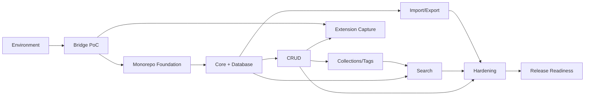

# Fluid Deck — Phase 3 Implementation Plan

*Phase 3: Implementation Planning | Planning only — no code, no installs, no scaffold | Date: 2026-11-08*
*Source of truth: PRD, ADRs (20), Phase 2.9 final review (READY FOR PHASE 3 WITH CONDITIONS). Ponytail full: smallest plan that works.*

## 1. Executive Summary
Fluid Deck MVP is buildable as planned: 18 Must-Have features, layered architecture, Dexie canonical, MiniSearch derived, bridge PoC-gated. This plan sequences 8 workstreams → 11 milestones (M0–M10), ~85 tasks, **~140–180 engineering hours** (engineering effort, not calendar). One mandatory gate: **bridge PoC must pass in Chrome/Firefox/Edge before Phase 4 full build** (failure = Phase 8 pairing-secret or redesign). No approved architecture change proposed.

## 2. Implementation Principles
1. Ponytail ladder: stdlib/native before deps; no Redux/Zustand/RHForm; no workers/virtualization until measured-necessary.
2. PoC before production: bridge, benchmark, canonicalization corpus first.
3. Ack-after-commit is inviolable (ADR-011).
4. Every milestone exits on measurable criteria, not "looks done".
5. Zero telemetry; no network egress beyond user-initiated open/thumbnails.
6. Docs-only until Phase 4 entry checklist (§12) passes.

## 3. Source Documents & Assumptions
All 19 Phase 1/2 docs reviewed (Phase 2.9 §2). **Conflicts found (recorded, not silently resolved):**
- **C-1 (stale audit):** `ENVIRONMENT_AUDIT.md` says Node v26.13.0 is "Non-LTS — pin to 22/20". **Outdated:** Node 26 entered **Active LTS 2026-10-28** (nodejs.org), supported to 2029-04-30. Recommendation: **keep v26.13.0**; update audit in Phase 4. Do not downgrade.
- **C-2 (stale workflow):** `DEVELOPMENT_WORKFLOW.md` §§2–3 describe Next.js/Prisma/backend phases — **superseded** by ADR-001/004 (Vite + Dexie, no backend). Recommend marking superseded in Phase 4; planning follows ADRs.
- Assumptions: pnpm 11 workspace; WXT MV3 output per browser; Dexie v1 additive migrations; MiniSearch rebuild-every-start; WCAG 2.2 AA.

## 4. Development Environment Readiness
Verified 2026-11-08 on Windows 11, Git Bash:
| Tool | Version | Status |
|---|---|---|
| Node.js | v26.13.0 (Lithium, Active LTS) | ✅ Keep. Pin via `.nvmrc`/engines; CI uses same |
| pnpm | 11.13.0 | ✅ Workspace manager |
| git | 2.55.0 | ✅ Not initialized (gated: Phase 4 SCAFFOLD-001) |
| tsc | not global | ⚠️ Not needed globally — local TS dep in Phase 4 |
| jq | missing | ⚠️ Optional (winget) — not on critical path |
| OneDrive path | `C:\Users\ADMIN\OneDrive\...\fluid-deck` | ⚠️ Git sync slow; Phase 4: `core.autocrlf true`, consider moving out of OneDrive (DEC-012) |
No `package.json`/scaffold exists — **correct** (docs-only to date). Missing tools: none blocking; tsc/jq are Phase 4 installs, not Phase 3 actions.

## 5. Workstream Breakdown (8)
W1 Bridge PoC (POC-*) → W2 Scaffolding (SCAFFOLD-*) → W3 Core+DB (CORE-*/DB-*) → W4 Frontend (UI-*) → W5 Search (SEARCH-*) → W6 Capture (EXT-*) → W7 Import/Export (IMPORT-*) → W8 QA (TEST-*). Each: tasks in `PHASE_3_TASK_BREAKDOWN.md`, milestones §7.

## 6. Dependency Graph

No circular chains (verified §11 of breakdown). Longest path: M0→M1→M2→M3→M4→M9→M10.

## 7. Milestone Plan (M0–M10)
| Milestone | Goal / Deliverable | Effort (hrs) | Exit criteria |
|---|---|---|---|
| M0 Environment | Toolchain verified, Node pin decided | 2–4 | ENV tasks green; C-1 recorded |
| M1 Bridge PoC | 3-browser PoC (send/ack/dup/retry) | 12–20 | 18-cell matrix (§8) green |
| M2 Foundation | pnpm workspace + web+ext shells build | 8–12 | SCAFFOLD-001–008 green |
| M3 Core+DB | Types, Zod, Dexie v1, repos, migration tests | 20–30 | DB-001–010 green; fake-indexeddb pass |
| M4 CRUD | Resource CRUD + grid + cards (seed data) | 20–28 | UI-001–005 green; TanStack CRUD works |
| M5 Collections/Tags | Nesting, tagging, inbox, palette | 20–26 | UI-006–011 green |
| M6 Extension | Production capture via proven bridge | 15–22 | EXT-001–007 green; ack-after-commit e2e |
| M7 Search | MiniSearch + facets + benchmark report | 15–22 | SEARCH-001–008 green; p95 measured |
| M8 Import/Export | HTML/JSON in; JSON/HTML/MD/CSV out | 20–30 | IMPORT-001–009 green; round-trip pass |
| M9 Hardening | Reliability, a11y, perf, security pass | 20–30 | TEST-001–008 green; axe-core 0 critical |
| M10 Release | Store listing, privacy policy, MVP tag | 10–16 | Phase 4 checklist (§12) all green |

## 8. Testing Strategy
Pyramid: unit (Zod/tokenizer/canonicalization) → repo/migration (fake-indexeddb) → component (RTL) → integration (bridge, import) → e2e (Playwright, 3-browser extension). Gates per milestone in breakdown. **Not run yet — planned only.**

### Bridge PoC Test Matrix (mandatory gate)
Dimensions: **browser** (Chrome/Firefox/Edge) × **app state** (open/closed) × **case** (happy-path ack, lost ack→dedup, duplicate delivery, invalid payload rejected, retry-after-timeout). 3×2×5 = 30 cells; pass = no data loss + no false "Saved" in any cell.

## 9. Performance & Accessibility Validation
Budgets remain **proposed** (ADR-019). Phase 4 measures: startup, grid render, search p95 at 1k/5k/10k, import 1k, export 10k, bundle gzip. a11y: axe-core (automated) + Playwright keyboard e2e + manual NVDA/VoiceOver pass at M9.

## 10. Security Implementation Checklist
- [ ] Bridge: origin+`MessageSender`+nonce+Zod on every message (never treat as crypto auth)
- [ ] Extension: 4 permissions only; `<all_urls>` documented in store listing
- [ ] CSP strict; text-only rendering (no raw HTML injection)
- [ ] Import: DOMPurify+Zod+caps; http(s)-only URLs
- [ ] Zero telemetry verified (no network egress in devtools audit)
- [ ] Full-delete guarded (export-first, type-to-confirm)

## 11. Risk Management
Top risks (full register in Phase 2.9 review §8): bridge spoofing (RSK-01, High), `<all_urls>` (RSK-02, High), data loss (RSK-03, High), MiniSearch rebuild @10k (RSK-04, Medium), canonicalization false merges U4 (RSK-05, Medium). Mitigations + owners in `PHASE_3_DECISION_REGISTER.md` (RISK section).

## 12. Phase 4 Entry Criteria (strict gate)
**Mandatory (all must pass):**
- [ ] Phase 3 plan reviewed & approved (this doc)
- [ ] Bridge PoC 30-cell matrix green in Chrome/Firefox/Edge
- [ ] Node pin finalized (recommend: v26 LTS, update ENVIRONMENT_AUDIT)
- [ ] Workspace structure approved (W2 plan)
- [ ] Database plan approved (W3 plan)
- [ ] Testing infra plan approved (Vitest/Playwright/axe-core)
- [ ] U1 + U4 resolved (reference implementations)
- [ ] No architecture blocker remains
**Can proceed in parallel:** U2/U5/U6 decisions (by end of Phase 3 implementation), jq install, OneDrive move.
**Failure rule:** bridge PoC fail → stop, redesign (pairing secret or local HTTP) with new ADR before Phase 4.

## 13. Estimated Effort
Engineering effort (excludes reviews/approvals/calendar waits): M0 2–4h, M1 12–20h, M2 8–12h, M3 20–30h, M4 20–28h, M5 20–26h, M6 15–22h, M7 15–22h, M8 20–30h, M9 20–30h, M10 10–16h → **~162–240h total** (breakdown sums ~140–180h for the 85 tasks + 20–60h for reviews/fixes). Calendar dates **not** invented — depends on throughput.

## 14. Implementation Execution Order
M0 → M1 → M2 → M3 → (M4 ∥ M7-scaffolding) → M5 → M6 → M7 → M8 → M9 → M10. Parallelizable: UI shell (M4/M5) with search after M3; import scaffolding after M3. **Never parallel:** two edits to same file; migration design vs repo impl.

## 15. Open Decisions
All U1–U6 + 5 additional items in `PHASE_3_DECISION_REGISTER.md`. **User decisions needed:** U2, U5, U6 (by end of Phase 3). **Phase 4 blockers:** U1, U4, retry/protocol values (R-1/R-2) — all ✅ user-approved 2026-11-08 (Phase 4 entry review). **No decision blocks planning itself.**
```text
*Recommendation: approve this plan; next step is Phase 4 M0/M1 (env + bridge PoC) — gated by §12.*
```
