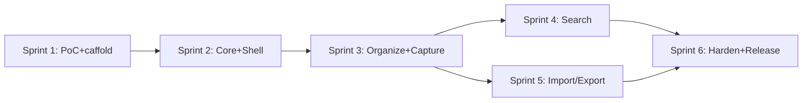

# Fluid Deck — Phase 4 Execution Roadmap

*Roadmap only — not permission to execute. Phase 4 starts only after §12 gate in PHASE_3_IMPLEMENTATION_PLAN.md.*

## Sprint 1 — Foundation (M0–M2)
Env pin (ENV-001) → bridge PoC (POC-001–005, **gate**) → git init + workspace (SCAFFOLD-001–006). **Stop if PoC fails** — redesign with new ADR before proceeding.

## Sprint 2 — Core (M3–M4)
Core types+Zod → Dexie v1 + repos → canonicalization (DB-007, needs U4) → app shell + grid + TanStack (UI-001–003). Seed data only; no extension yet.

## Sprint 3 — Organize + Capture (M5–M6)
Collections/tags/inbox/palette/settings (UI-005–010; needs U1, U2, U5, U6) → production extension capture (EXT-001–007; R-1/R-2 ✅ user-approved 2026-11-08).

## Sprint 4 — Search (M7)
Tokenizer → MiniSearch → rebuild → facets → **benchmark report** (SEARCH-006). If >500ms @10k: activate worker seam (SEARCH-007). Update budgets from "proposed" to measured.

## Sprint 5 — Portability (M8)
Import parsers → batch/resume → export 4 formats → e2e round-trip. Import caps: 50MB HTML / 20MB JSON proposed (ADR-009).

## Sprint 6 — Hardening & Release (M9–M10)
Reliability → a11y (axe-core + SR) → perf → security → store listing → MVP tag. Phase 4 exit checklist = Implementation Plan §12.

