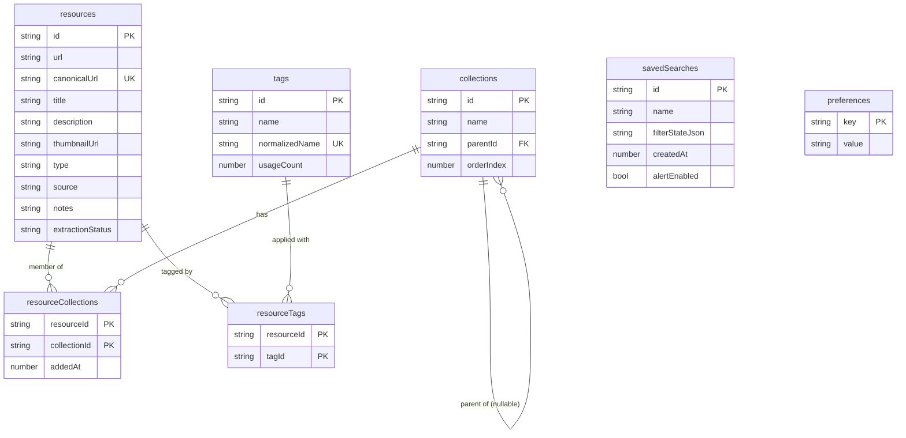
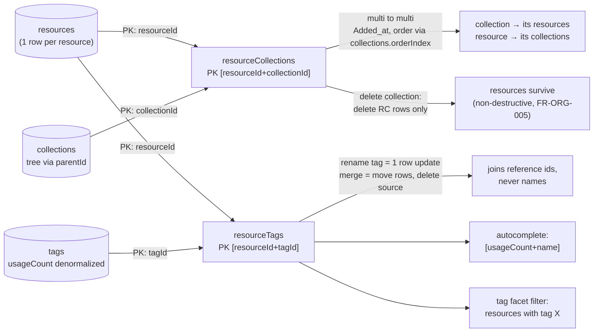
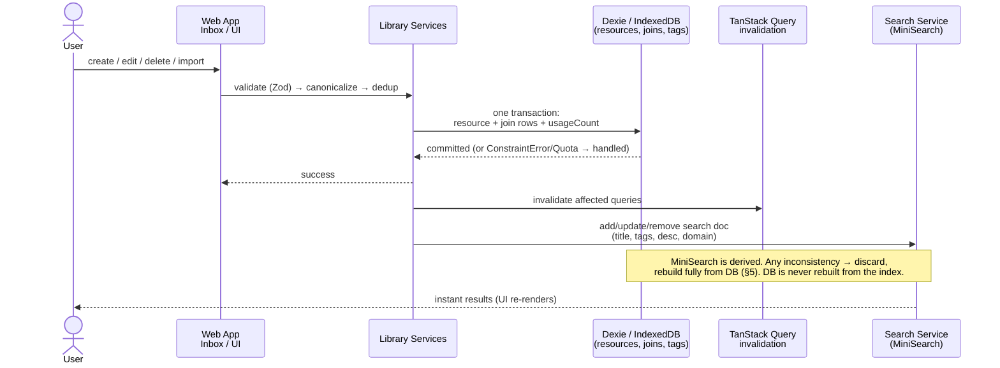
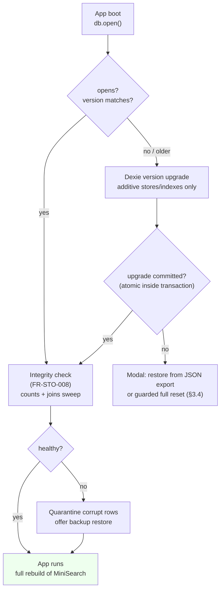

# Database Schema & Migrations — Fluid Deck

*Phase 2.2 | Status: Draft for approval | Date: 2026-11-08*
*Sources: PRODUCT_VISION, PRODUCT_REQUIREMENTS_DOCUMENT (FR-STO-001–008, FR-CAP, FR-SRH, FR-ORG, FR-IEX), INFORMATION_ARCHITECTURE, MVP_FEATURE_PRIORITIZATION, USER_JOURNEYS_AND_WORKFLOWS, TECHNICAL_DIRECTION_EVALUATION, PHASE_1_FINAL_REVIEW, SYSTEM_ARCHITECTURE (Phase 2.1)*

> Design-only. No application code, no actual Dexie migrations. Schema details belong here; messaging contracts belong to Phase 2.3.

## 0. Key Decisions (read first)

| # | Decision | Rationale |
|---|---|---|
| D1 | **Join tables, not embedded arrays** for Resource↔Collection and Resource↔Tag | IndexedDB has no multi-entry index on nested arrays except top-level arrays; join tables give compound unique PK (prevents duplicates for free), bidirectional queries ("resources in collection X" and "collections of resource Y") with plain indexes, and safe bulk deletes. Embedded arrays can only be indexed if the array itself is the indexed field, and removal is a full-object rewrite. |
| D2 | **7 stores, no import/export tracking store** | Import/export tracking is not justified by any FR. Preview-then-commit (FR-IEX-003) needs no persistent history. Adding one is theoretical extensibility (ponytail: add when an audit requirement exists). |
| D3 | **View State is NOT a table** | PRD/IA: filter state lives in the URL (FR-SRH-003) and is transient. Only the persisted *sort preference* and UI prefs go in `preferences`. A ViewState table would duplicate the URL. |
| D4 | **UTF-16 strings for IDs as UUIDs, generated client-side** | IndexedDB `++/id` auto-increment was the alternative; rejected — captures arrive from the extension with a UUID (§2.1 handoff idempotency), and auto-increment couples identity to insertion order. Client UUIDs are merge-safe for the future sync seam (§15 of SYSTEM_ARCHITECTURE). |
| D5 | **Soft delete via `deletedAt`, 30-day purge** | FR-STO-007. Trash is a virtual view (`deletedAt != null`), not a table. |
| D6 | **`canonicalUrl` carries a unique index** | Dedup authority (SYSTEM_ARCHITECTURE §10, Zone C). This is the one unique constraint IndexedDB enforces for free. |
| D7 | **Derived fields stored, not computed** | `domain` (for filtering), `usageCount` on Tag — denormalized counters/derived values maintained by Library Services, because IndexedDB has no computed indexes or triggers. Cost: services must update them atomically (see §4). |

## 1. Entity Inventory (evaluated per brief)

| Entity | Store? | Why / why not |
|---|---|---|
| Resource | ✅ `resources` | Core unit (FR-STO-002). |
| Collection | ✅ `collections` | Nestable, ordered tree (FR-STO-003). |
| Tag | ✅ `tags` | Global flat entities (FR-STO-005). |
| Resource–Collection | ✅ `resourceCollections` (join) | Dedicated membership store already required by FR-STO-004 (`resource_id, collection_id, added_at`). |
| Resource–Tag | ✅ `resourceTags` (join) | Mirrors collections join; makes "tags of resource", "resources with tag", and merge/rename queries index-only. |
| Saved Search | ✅ `savedSearches` | FR-STO-006 explicitly requires it (`id, name, filter_state_json, created_at, alert_enabled`). Note: S5 saved-search *surfacing* is post-MVP per MVP prioritization; the store ships so the table exists, but UI/tests may defer exposing it until S5. `alert_enabled` is kept (schema-complete) but unused in MVP — no alert machinery built. |
| View State | ❌ no store | URL-encoded transient (IA §3, FR-SRH-003). Bind exception: sort preference persisted in `preferences`. |
| Application Settings | ✅ `preferences` (key-value) | Density, sidebar, sort-per-view, purge interval, onboarding-seen. One row per key, read once at boot. No settings *table* of fixed columns — prefs evolve without migrations. |
| Import/export tracking | ❌ no store | No FR requires history; preview/commit is transactional (§4). |

## 2. Resource Modeling

### 2.1 Store: `resources` (Dexie: `resources`)

| Field | Type | I/O | Default | Notes |
|---|---|---|---|---|
| `id` | string (UUID) | user-owned | — | PK. Generate at capture, before delivery. |
| `url` | string | extracted | — | Original captured URL, never modified. |
| `canonicalUrl` | string | derived | = `url` | Normalized (§2.4). **Unique index.** |
| `title` | string | extracted, user-editable | from URL slug | User edits overwrite in place. |
| `description` | string | extracted, user-editable | `""` | |
| `thumbnailUrl` | string | extracted | `""` | URL only — no Blob download in MVP (quota, SYSTEM_ARCHITECTURE §7). |
| `faviconUrl` | string | extracted | `""` | First-party origin favicon; fallback leg of chain. Storing avoids per-render third-party fetch. |
| `domain` | string | derived | from canonical host | Lowercased hostname. Filter/sort support. |
| `type` | enum: `article\|video\|github\|npm\|pdf\|design\|tool\|other` | extracted+user-overridable | `other` | 8 types (PRD FR-CAP-004; IA says 7 variants rendered — canonical badge `other` covers the gap; see §6 U3). |
| `source` | enum: `extension\|import\|share\|other` | system | `extension` | `cli`/`api` not in MVP enumeration. |
| `notes` | string | **user-owned** | `""` | FR-STO-002 field. Included in JSON/MD export only (FR-IEX-005). |
| `extractionStatus` | enum: `complete\|partial\|failed` | derived | `complete` | Set by the extractor chain. |
| `extractionNotes` | string[] | derived | `[]` | Machine-readable failed steps, e.g. `["og:image:no-match"]`. Enough to render fallback UX; not a log. No telemetry sentinel. |
| `createdAt` | number (epoch ms) | system | `Date.now()` | |
| `updatedAt` | number (epoch ms) | system | `= createdAt` | Bumped on any field or membership change. |
| `lastOpenedAt` | number \| null | system | `null` | Set when user opens the resource; powers "Recently Opened" sort (FR-SRH-005). Null until first open. |
| `deletedAt` | number \| null | user-owned | `null` | Soft delete; null = live. |

**Field provenance (brief requirement):**
- **User-owned:** `title`, `description`, `type` (once edited), `notes`, `deletedAt`, collection/tag assignments (join stores).
- **Extracted (third-party-derived):** `url`, `thumbnailUrl`, `faviconUrl`, title/description before first edit.
- **Derived:** `canonicalUrl`, `domain`, `extractionStatus/Notes`, timestamps, `usageCount` (tags).

**Indexes (Dexie v1, `resources`):** `id` (PK), `canonicalUrl` !unique, `type`, `source`, `domain`, `[deletedAt+createdAt]` (Trash + purge scans), `createdAt`, `updatedAt`, `lastOpenedAt`, `type+createdAt`, `source+createdAt`. Tie-break sorts by `id` in queries, not the schema (ponytail).

### 2.2 Store: `collections` (Dexie: `collections`)

| Field | Type | Default | Notes |
|---|---|---|---|
| `id` | string (UUID) | — | PK. |
| `name` | string | — | Required, non-empty (service-enforced). |
| `parentId` | string \| null | `null` | `null` = top-level. |
| `orderIndex` | number | — | Sibling ordering (fractional index computed by service — see §6 U1). |
| `createdAt` | number | now | |
| `updatedAt` | number | now | Rename/reparent bump. |

Indexes: `id` PK, `parentId`, `[parentId+orderIndex]`, `name`. Nesting is enforced in services (max 3 levels recommended → soft check, PRD IA §4; depth 4+ warns, never hard-blocks — see §6 U2). **Unorganized is virtual**: no row. View query = resources with zero `resourceCollections` rows (left-anti-join in query code, single indexed sweep per render). Deleting a collection deletes only its `resourceCollections` rows; child collections' `parentId` reassigned to the deleted parent or `null` (service, §4).

### 2.3 Store: `tags` (Dexie: `tags`)

| Field | Type | Default | Notes |
|---|---|---|---|
| `id` | string (UUID) | — | PK. |
| `name` | string | — | Canonical display name. |
| `normalizedName` | string | `name.toLowerCase()` | **Unique index.** Autocomplete/dedup key; case-insensitive uniqueness without collation support in IndexedDB. |
| `usageCount` | number | `0` | Denormalized count of `resourceTags` rows. Service-maintained in the same transaction (D7). |
| `createdAt` | number | now | |

Indexes: `id` PK, `normalizedName` !unique, `[usageCount+name]` (autocomplete ranking). Rename = update `name` (+ re-derive `normalizedName`); merge = move join rows + delete source tag (§4). Tag names are free-form (IA tag UI) — no convention enforced.

### 2.4 URL Normalization & Deduplication

Given the authoritative dedup authority is the web app Inbox (SYSTEM_ARCHITECTURE §10), this section is the contract `core` implements and Dexie enforces:

**Canonicalization rules** (order matters; each is a pure function, reusable in extension for pre-check):
1. Trim, parse via `URL`; lowercase scheme + host; strip leading `www.`; decode punycode (URL does this).
2. Drop fragment (`#…`) — fragments are client-side state, never resource identity.
3. Drop default ports (`:80`, `:443`).
4. Tracking params removed: `utm_*`, `fbclid`, `gclid`, `msclkid`, `mc_` prefix, `igshid`, `yclid`. **All other query params are kept, sorted lexicographically** — they frequently change content (GitHub `?tab=…`, pagination, docs versions). This is the canonicalization boundary: only *known tracking* is stripped, everything else is identity.
5. Trailing slash: normalize `/` vs `""` for root only; preserve interior paths exactly (paths can be case-sensitive on some hosts — never lowercase the path).
6. `doi.org` / `arxiv.org` aliases and scheme aliases (github.io, bit.ly) are **not** canonicalized — out of scope and a false-positive factory.

**Duplicate detection:** `canonicalUrl` unique index on insert + a pre-insert `get` in the Inbox → conflict modal (Update Metadata / Add to Collections / Add Tags / Skip, FR-CAP-006). Race between two captures of the same URL: unique index fails the loser; service catches `ConstraintError` and treats it as the duplicate path.

**False-positive risks (explicit):** stripping non-tracking params would merge distinct resources (e.g. `example.com/post?ref=a` vs `?ref=b` — different referrers, same page → correctly merged; true distinct pages sharing only domain/path+tracking — acceptable, user-overridable); UTM-heavy pages where a param *does* select content (rare — user can edit URL field to force new record); SPA routes where content lives in the fragment (e.g. `app.com/#/doc/123` vs `#/doc/456` — **fragment-stripping merges these**; mitigation: hosts with hash-routed paths are an explicit exception list in `core` (open question U4, §6) — the schema stores `url` original so nothing is lost, and the modal always offers "Save as separate").

## 3. Dexie Schema & Migrations

### 3.1 Proposed database
- **Name:** `fluid-deck` (one database per browser profile; no per-workspace sharding — MVP is single-library).
- **Initial version:** `1`. Stores (Dexie syntax, design-only):

```
resources:           ++/id is WRONG → 'id, canonicalUrl!, type, source, domain, [deletedAt+createdAt], createdAt, updatedAt, lastOpenedAt'
collections:         'id, parentId, [parentId+orderIndex], name'
tags:                'id, normalizedName!, [usageCount+name]'
resourceCollections: '[resourceId+collectionId], resourceId, collectionId'   (PK = compound; see below)
resourceTags:        '[resourceId+tagId], resourceId, tagId'
savedSearches:       'id, name'
preferences:         'key'
```

Notes: `id` string UUID is the PK (D4). Join stores use a **compound primary key** `[resourceId+collectionId]` / `[resourceId+tagId]` — the PK itself blocks duplicate membership rows; secondary indexes serve the reverse direction. `canonicalUrl!` and `normalizedName!` are Dexie unique indexes (only enforced uniques in the DB). All other uniqueness = service-enforced.

### 3.2 What IndexedDB cannot enforce (and where services enforce it)
| Constraint | Enforced by |
|---|---|
| `canonicalUrl` / `normalizedName` uniqueness | IndexedDB unique indexes ✅ |
| No duplicate join rows | Compound PK ✅ |
| Every `resourceId`/`collectionId`/`tagId` references an existing parent | **Services.** IndexedDB has no FKs. All writes go through Library Services (single-writer principle, SYSTEM_ARCHITECTURE §3). |
| Collection parent exists; no cycles; depth warning at 4 | **Services.** Cycle-check on reparent (walk ancestors before write). |
| Unorganized = derived, not stored | Query construction, not schema. No orphan-check needed — membership-less resources are valid. |
| `usageCount` correctness | Services increment/decrement in the same Dexie transaction as the join-row change. |
| `deletedAt` semantics, 30-day purge | Services + a purge sweep run at app boot + Trash view. |
| Non-empty collection/tag names | Zod at the service boundary (Phase 2.3 contract surface; here: service rule). |

### 3.3 Versioned migration strategy
- **Additive-only discipline for v1→v2+:** new versions add stores/indexes (Dexie `db.version(n).stores({...})`), never rename/drop without a data-transform upgrade. Dexie `upgrade()` hooks run **inside a transaction** — a failed upgrade leaves the DB untouched (IndexedDB atomicity).
- Every version change = schema bump + a documented upgrade function + a round-trip test (export JSON → upgrade → verify counts). Upgrade functions are idempotent; partial failure restarts from the same version on next open.
- **Existing user data during upgrades:** preserved by construction; upgrades are additive; backfill steps (e.g. new `domain` field) run as a chunked, resumable pass with progress in the UI; `updatedAt` is *not* touched by backfills.
- **Failure / corruption:** `dexie.open()` failure → startup integrity check (FR-STO-008) detects version/corruption state → modal offers Restore from JSON export or full reset (never silent). A checksum/integrity pass over `resources` + joins runs at boot (counts + spot checks), cheap at 10k scale.

### 3.4 Reset safeguards
Full delete requires: in-app confirmation dialog + explicit typing or equivalent guard, exports a JSON backup *prompted first* (not forced — user owns their data, FR-PRI-002), then `db.delete()` and re-create at v1. Reset is the only operation allowed to call `db.delete()`; nowhere else in the codebase.

## 4. Data Lifecycle & Reliability

| Operation | Transaction boundary | Behavior |
|---|---|---|
| Resource create (capture/import) | Inbox/Library write: resource + join rows + `usageCount` bumps in **one Dexie transaction** | ConstraintError on `canonicalUrl` → duplicate path; QuotaExceededError → write aborted, draft stays queued (extension) or import entry marked failed — never half-written. |
| Resource edit | Single-row `put` + `updatedAt` | Optimistic UI via TanStack Query; rollback on failure; `lastOpenedAt` writes are fire-and-forget (never block navigation). |
| Soft delete / restore | `put deletedAt` + `usageCount` unchanged | Membership joins retained (restore is lossless); purge = delete resource + joins in one transaction, only after 30 days or explicit Trash purge. |
| Collection delete | Delete join rows for that collection + reassign children in **one transaction** | Resources themselves untouched (FR-ORG-005). |
| Tag delete | Delete join rows + decrement counts on each affected tag → delete tag row, one transaction | Orphaned tags (usageCount 0) are auto-removed by the same sweep; **renames** are a single tag-row update (joins reference `tagId`, not name — zero cascade cost). |
| Tag merge | Move source join rows to target (skip PK conflicts), delete source tag — one transaction | `usageCount` recomputed for target in the same transaction. |
| Import (HTML / Raindrop) | Preview (no writes) → commit in **batches of 500** per transaction | Per-batch failure: batch rolls back, previous batches stand, user is told exactly how many committed and can re-run — no partial-batch ambiguity, no silent loss (FR-IEX-003/006). Conflicts resolved pre-commit per user choice. |
| Bulk-import failure behavior | Aborts at first failing batch, retains prior batches | Safe re-run: dedup makes re-import idempotent. |
| Export | Read-only snapshot | TanStack Query read transaction across the four export passes for a consistent snapshot; export never writes. Thumbnails excluded by default (FR-IEX-005). |
| Corruption / DB unavailable | Boot-time integrity check | Quarantine corrupt rows (exclude from search/grid), offer backup restore, never delete silently. |

**Atomicity expectation:** exactly one Dexie transaction per logical mutation; cross-transaction atomicity is *not* assumed anywhere (import batches are the deliberate exception, with idempotent re-run semantics).

## 5. Search Indexing (MiniSearch — derived only)

- **Authoritative:** `resources` + `tags` (via `resourceTags`). MiniSearch is a rebuildable in-memory view (SYSTEM_ARCHITECTURE §§6/8).
- **Indexed fields:** `title` (boost 3), tag names (boost 2), `description` (boost 1), `domain`, `canonicalUrl` (boost 0.5). From tag names joined in, not stored on the resource — the search document is assembled at index time.
- **Build:** full rebuild from Dexie on app load (target <50ms p95 at 10k per FR-SRH-001 measurement budget; chunked build so first paint isn't blocked).
- **Invalidation/sync:** Search Service subscribes to the same TanStack Query invalidations the UI gets; every create/update/delete/import commits → search doc add/update/remove in the same app tick. `deletedAt` set = remove from index immediately.
- **Facets** computed at query time over the result set (type/collection/tags/date/source) — sets match IA §3 chips.
- **Recovery:** any index inconsistency = discard and rebuild (no repair protocol exists *because* the index is disposable — that is the point). A "Rebuild index" action in Settings is the user-visible recovery. No FTS5/semantic in MVP.

## 6. Decisions, Trade-offs, Traceability, Open Questions

**Decisions & alternatives considered**
- Join tables vs. embedded arrays + multi-entry indexes → joins (D1). Embedded arrays rejected: Dexie multi-entry indexing on an array field *is* possible, but (a) duplicate values in an array need service-side dedup anyway, (b) membership removal rewrites the whole resource row, (c) reverse queries ("all resources tagged X") need the array index to be on the tag field — fine — but (d) `usageCount` per tag then needs a scan per mutation. Joins cost one extra store each and buy bidirectional queries + PK dedup.
- UUID vs. `++/id` auto-increment → UUID (D4): capture IDs already exist (§2.1 of SYSTEM_ARCHITECTURE); sync-deferred merge key.
- View State as table vs. URL-only → URL-only + `preferences` (D3), per IA §3.
- Import/export tracking store → not built (D2): no FR requires it.
- **Alternatives weighed and rejected:** event-sourcing/append-only log (justifiable for sync, overkill for MVP single-writer); SQLite WASM now (premature — SYSTEM_ARCHITECTURE §0/§15); content-addressed thumbnails (quota + complexity without a download requirement); case-insensitive IndexedDB collation (unavailable — `normalizedName` workaround instead).
- **Trade-offs:** join tables = more writes per organize action (2–3 row writes), but each is an indexed point-write (<1 ms) — correct trade. Denormalized `usageCount` = one extra write per tag op, buys O(1) autocomplete ranking. UUIDs = 36 chars vs. small ints — storage cost negligible at 10k scale.

**Risks & mitigations:** quota/Blob pressure (thumbnail URLs only); `usageCount` drift (single-transaction updates + boot-time recompute pass); join-row orphans (single-writer services + boot integrity sweep); canonicalization false merges (original `url` always kept; modal lets user force a new record); 10k-row import transaction duration (500-row batches).

**Unresolved questions / assumptions (NOT silently resolved)**
- **U1 (assumption):** fractional `orderIndex` — service computes midpoints between siblings. Needs Phase 2.3/implementation confirmation of the fraction strategy.
- **U2 (recommendation):** collection depth — IA recommends max 3, warns at 4. Schema permits any depth (no DB constraint); recommend **soft warning at depth 4, hard cap nowhere** (user freedom, per IA principle; PRD open question #4 unresolved — needs user input).
- **U3 (assumption):** Resource `type` enum is 8 values (PRD FR-CAP-004); IA renders 7 card variants. Schema stores 8; card layer maps one enum (`other`) to the default variant.
- **U4:** hash-routed SPA exceptions for fragment-stripping (§2.4) — needs a `core` exception list; deferred to Phase 2.3 contract work.
- **U5:** auto-purge interval default 30 days (FR-STO-007) — configurable via `preferences`; GDPR question open in PRD §20.
- **U6:** tag-name convention (PRD open question) — schema enforces only non-empty; kebab-case vs. free-form needs user decision.
- Deferred to Phase 2.3+: Zod shapes for all stores, Inbox validation flow, bridge protocol, fractional-index rules.

**Traceability:** FR-STO-001 (Dexie/IndexedDB local-first → §3) · FR-STO-002 (Resource fields → §2.1) · FR-STO-003 (Collection hierarchy → §2.2) · FR-STO-004 (membership → `resourceCollections`) · FR-STO-005 (tags/usage counts → §2.3) · FR-STO-006 (SavedSearch → §1) · FR-STO-007 (soft delete/purge → §§2.1, 4) · FR-STO-008 (integrity at boot → §3.3) · FR-CAP-004/005/006 (type, normalization, dedup → §2.4) · FR-ORG-001–006 (collections/tags/bulk ops → §§2.2, 2.3, 4) · FR-SRH-001–005 (MiniSearch, facets, URL state, sort → §5 + D3) · FR-IEX-001–006 (import/export, preview, conflicts → §4) · FR-PRI-002/003 (full delete, no auth → §3.4) · SYSTEM_ARCHITECTURE §§3/6/8 (boundaries, storage ownership, derived search) — no contradictions found.

## 7. Required Diagrams

### 7.1 Entity relationship diagram


### 7.2 Resource-to-collection and resource-to-tag relationships


### 7.3 Database write and search-index update lifecycle


### 7.4 Database version upgrade and migration lifecycle

