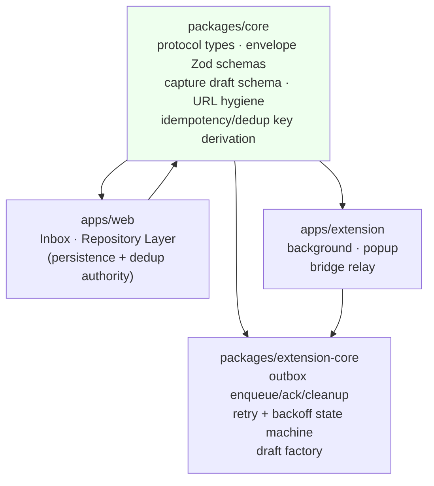
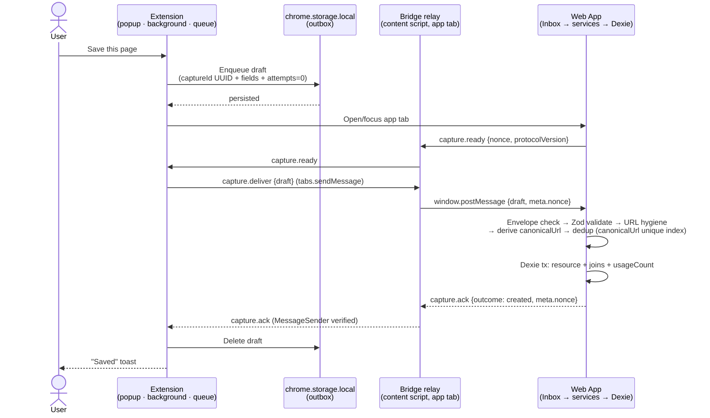
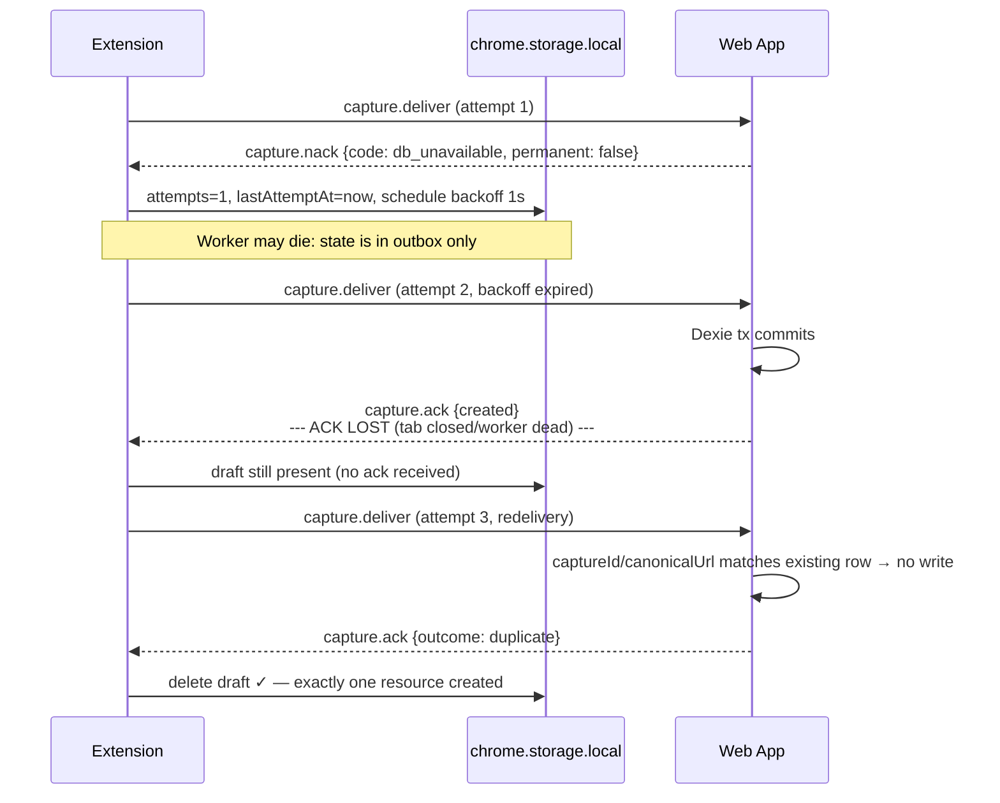
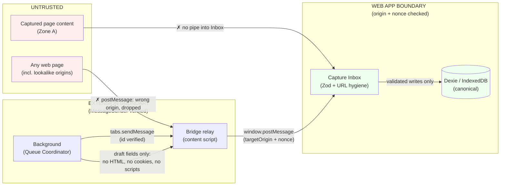

# Extension ↔ Web App Communication Contracts — Fluid Deck

*Phase 2.3 | Status: Draft for approval | Date: 2026-11-08*
*Sources: PRODUCT_REQUIREMENTS_DOCUMENT (FR-CAP-001–008, FR-STO-001–008), INFORMATION_ARCHITECTURE, SYSTEM_ARCHITECTURE (Phase 2.1), DATABASE_SCHEMA_AND_MIGRATIONS (Phase 2.2), PHASE_1_FINAL_REVIEW*

> Documentation-only. No code, no actual Zod schemas, no messaging implementation. Field *shapes* below are contract specifications; implementation belongs to Phase 4+.

## 0. One-paragraph summary

**At-least-once delivery over a 3-hop bridge, idempotent by capture ID, acked only after IndexedDB commit.** Four message types total (`deliver`, `ack`, `nack`, `hello`/`ready`). No new abstraction, no backend, no local HTTP. Contracts live in `packages/core` as pure TypeScript + Zod; browser APIs never leak into them.

## 1. Protocol Overview

- **Protocol name:** `fluiddeck.capture` (an application-level namespace, not a URL scheme).
- **Protocol version:** `1` (integer, starts at 1). Every envelope carries it. Major version bumps are the only version-negotiation event; receivers reject unknown majors with `nack{code: version}`. No minor-version handshaking — unknown fields are ignored (forward-compatible).
- **Transport:** three hops, each hop has its own trust check (see §4):
  1. Extension background (Queue Coordinator) → content-script bridge relay inside the Fluid Deck tab: `tabs.sendMessage` / `runtime.onMessage` (browser-verified sender = this extension).
  2. Bridge relay → web app page: `window.postMessage` with `targetOrigin` pinned to the allowed app origin, plus a per-delivery nonce (see §4.3).
  3. Web app → back: identical reverse path, `window.postMessage` to relay, relay forwards to background via `runtime.sendMessage`.
- **Delivery guarantee:** at-least-once. **Exactly-once resource creation** is achieved by idempotency (capture ID + `canonicalUrl` unique index), *not* by transport. The transport may deliver twice; the DB creates one row.
- **Directions:** extension → web (`deliver`, `hello`); web → extension (`ack`, `nack`, `ready`).

## 2. Message Envelope (§4A)

Every message on every hop shares one shape. Fields marked **M** are mandatory; **O** optional.

| Field | Type | M/O | Why mandatory |
|---|---|---|---|
| `protocol` | `"fluiddeck.capture"` | M | Namespaces messages; lets a receiver ignore anything else on the channel (other `postMessage` traffic, third-party widgets). |
| `protocolVersion` | integer | M | Rejection path for incompatible implementations (`nack{code:version}`). |
| `type` | enum (see §3) | M | The message's meaning. |
| `messageId` | UUID string | M | Identifies *this transmission attempt* (not the capture). Used to match an `ack`/`nack` to a `deliver` within one attempt and to debug logs. Fresh per attempt. |
| `captureId` | UUID string | M (all types) | Identifies *the capture* across attempts. The idempotency key. Present on acks/nacks so the extension knows which outbox row to clear. |
| `sentAt` | epoch ms integer | O | Diagnostics + clock-skew sanity (stale message cutoff). Not used for ordering — ordering is by `captureId` semantics, not timestamps. |
| `senderRole` | `"extension" \| "webapp"` | M | Receiver asserts the peer's role before interpreting the payload. Prevents a captured page from masquerading as the web app toward the relay (ack forgery). |
| `payload` | object (per-type, §3) | M | The body. Schema-validated per type by the receiver. |
| `meta` | `{ nonce?: string, attempts?: number }` | O | Bridge internals only (delivery-session nonce, retry count for diagnostics). Never persisted. |

**What is *not* in the envelope, deliberately:** no auth token, no secret, no origin string (origin is verified from transport metadata), no user ID (no accounts in MVP), no source page URL beyond the payload's resource URL. Minimal surface = minimal leakage.

**Envelope size limits** (ponytail — generous but bounded): whole message ≤ 64 KiB serialized; any single string field ≤ 8 KiB (title/description/thumbnail/favicon URL); total payload ≤ 32 KiB. Oversized → `nack{code:payload_too_large, permanent:true}`. 64 KiB comfortably fits the largest legitimate draft (a long description + a few URLs), so this rejects attacks/junk, never real captures.

## 3. Message Types (§4B/4C) — Four Types, Nothing More

Three alternatives were rejected: a rich status taxonomy (unneeded — the extension only needs "done / try later / give up / never"), a generic `error` type (the extension cannot act differently on different payloads unless `code` is standardized — so error details ride inside `nack.payload.code` instead of new types), and `hello`/`ping` *pairs* (one type each direction suffices).

| `type` | Direction | Payload shape | Never sent before |
|---|---|---|---|
| `capture.deliver` | extension → web | Capture draft (§3.1) | Outbox persistence (§5) |
| `capture.ack` | web → extension | `{ captureId, outcome: "created" \| "duplicate", resourceId: string (O), duplicateOf?: string }` | Dexie transaction commit |
| `capture.nack` | web → extension | `{ captureId, code, permanent: boolean, message?: string }` | — |
| `capture.ready` | web → extension | `{ nonce: string, protocolVersion: integer }` | App fully loaded + Inbox initialized |

### 3.1 Capture draft (`capture.deliver` payload)

Required fields map 1:1 to `resources` columns (Phase 2.2) — no orphan fields:

| Field | Required | Phase 2.2 column | Notes |
|---|---|---|---|
| `captureId` | ✅ (also envelope) | — (outbox ID; becomes `resources.id` on create) | UUID generated at enqueue, preserved end-to-end |
| `url` | ✅ | `resources.url` | Original captured URL |
| `title` | ✅ (may be `""`) | `resources.title` | `""` → Inbox derives from URL slug |
| `capturedAt` | ✅ | `resources.createdAt` (on create) | Timestamp of extraction; `createdAt` set to this on insert |
| `source` | ✅ (`"extension"`) | `resources.source` | Fixed for this transport; import path writes directly |
| `description` | O | `resources.description` | |
| `thumbnailUrl` | O | `resources.thumbnailUrl` | `""` = absent |
| `faviconUrl` | O | `resources.faviconUrl` | |
| `type` | O (default `"other"`) | `resources.type` | 8-value enum (FR-CAP-004) |
| `extractionStatus` | O (default `"partial"` if any field missing) | `resources.extractionStatus` | `complete\|partial\|failed` |
| `extractionNotes` | O (default `[]`) | `resources.extractionNotes` | Machine-readable failure steps |
| `collectionIds` | O | join rows (not a resource column) | IDs of *existing* collections only; unknown IDs are silently dropped by Inbox (never created implicitly) |
| `tagIds` | O | join rows | Same rule as collections |
| `tagNames` | O | → create-or-get `tags` rows | User-typed new tags; Inbox resolves via `normalizedName` (case-insensitive) before write |
| `notes` | O | `resources.notes` | User text from popup |

**Deliberately excluded:** `canonicalUrl` (Inbox derives it — extractor's value is an untrusted hint, not authoritative; §4), `domain`, `createdAt/updatedAt` (Inbox/Dexie set them), `deletedAt`, `lastOpenedAt`, `usageCount`, any search field, and — critically — **no raw HTML, no page content, no attachments, no cookies**. The draft is metadata + user intent only.
**`canonicalUrl` may be included as `canonicalUrlHint`** (O) for pre-check UX (fast "duplicate?" hint in popup); the Inbox recomputes and ignores it for identity.

### 3.2 Acknowledgement (`capture.ack`)
- `outcome: "created"` — new row committed. `resourceId` = new resource's ID (`= captureId` in practice).
- `outcome: "duplicate"` — the capture resolved to an existing row (by capture ID already processed, or by `canonicalUrl`). `duplicateOf` = existing resource's ID. **A duplicate is a success** — the extension deletes the outbox row.
- An ack is a statement about the database, not the network: *"a Dexie write for this capture committed."* Nothing else.

### 3.3 Failure (`capture.nack`) — one type, `code` + `permanent`
| `code` | `permanent` | Extension action |
|---|---|---|
| `version` | true | Discard draft; surface "extension and app versions incompatible — update Fluid Deck" |
| `payload_too_large` | true | Discard; surface "capture too large" |
| `invalid_payload` (Zod rejection) | true | Discard; log reason for diagnostics |
| `invalid_url` (non-http(s) scheme, `javascript:`, `data:`) | true | Discard; same |
| `quota` (IndexedDB `QuotaExceededError`) | false | Keep queued; backoff retry; surface export-then-delete guidance |
| `db_unavailable` | false | Keep queued; retry on next app-ready |
| `transient` (catch-all retryable) | false | Keep queued; backoff retry |

Permanent = delete from outbox immediately, never retry. Retryable = keep, increment attempt counter.

### 3.4 Readiness (`capture.ready`)
Sent by the web app **once per tab load**, after the Inbox is listening and IndexedDB is open. Payload carries a fresh per-load `nonce` (UUID, sessionStorage-scoped — never persisted) and the app's `protocolVersion`. Purpose: lets the extension *know* delivery can succeed, and binds subsequent acks to this specific app load (§4.3 anti-forgery). Not a ping/pong loop — readiness is announced once; the extension polls only when it has queued drafts and no recent `ready` (§5).

## 4. Security and Trust Boundaries (§5)

### 4.1 Allowed Fluid Deck origins
The bridge relay may only run on the deployed web app's origin(s), declared once in the extension manifest as `externally_connectable` (web app is PWA-hosted; the exact production origin is designated at Phase 4 build time and is the **single** origin in the allowlist — no wildcard). Development (`localhost`) origins must be under a separate, build-time flag, never merged into the production allowlist. Any other origin: relay never injects, messages never flow.

### 4.2 Hop-by-hop verification
| Hop | Verified how | What that proves |
|---|---|---|
| Extension → relay (content script) | `MessageSender` from `tabs.sendMessage`/`runtime.sendMessage` (browser-provided, cannot be spoofed by a page) | The message came from *this* extension's background script |
| Relay → web app (`window.postMessage`) | Relay checks `event.origin === ALLOWED_APP_ORIGIN` and `event.data.protocol === "fluiddeck.capture"` before forwarding | Only the app origin can trigger relay actions; other pages' messages are ignored |
| Web app → relay | Web app sends with `targetOrigin` = allowed origin; relay checks `event.origin` matches on receipt; relay checks envelope `senderRole === "webapp"` and nonce (§4.3) | Only the app on that origin can produce acks |
| Relay → extension | `runtime.sendMessage` only if `senderRole` verified by relay above | Forged acks from arbitrary pages never reach the background |

### 4.3 The nonce handshake (smallest anti-forgery mitigation)
On each app load the web app generates `nonce`, stores it in `sessionStorage`, includes it in `capture.ready`. The relay stores it (closure-scoped, memory only). On `capture.deliver`, the **relay** injects the current `nonce` into `meta.nonce` before posting to the page. Acks must echo the same `meta.nonce`. Consequences:
- A page at a *different* origin cannot produce a valid ack (wrong origin + no nonce).
- A page at the *same* origin but a different tab cannot ack (each tab load has its own nonce; acks are matched by nonce + `captureId`).
- An arbitrary web page posting directly to the bridge relay (bypassing the origin check) is dropped.

**Honest limits (what this is NOT):** `window.postMessage` origin checks and nonces are *integrity/origin checks, not cryptographic authentication*. There is no shared secret between extension and web app (and adding one would require key distribution between a PWA and its extension — complexity without a demonstrated threat). What is guaranteed: transport-level origin separation + schema validation + nonce binding across tabs. What is *not* guaranteed: an attacker who already controls the allowed app origin (e.g., XSS in the web app itself) can produce arbitrary messages — but XSS is a web-app compromise where postMessage forgery is the least of the problems, and the schema validation + Inbox checks in §4.4 still apply. No backend, no local HTTP, no native messaging was introduced to solve this; none is needed for the MVP threat model (local-first, single user, user's own machine).

### 4.4 Inbox validation rules (web app, every message, no exceptions)
1. Envelope: `protocol === "fluiddeck.capture"`, `protocolVersion` supported, `type` known, `senderRole === "extension"` (for `deliver`), `messageId`/`captureId` valid UUIDs, `meta.nonce` matches the current load's nonce.
2. `capture.deliver` payload: Zod-validated against the §3.1 shape; string length + 64 KiB caps enforced.
3. URL hygiene: `url` must parse as absolute `https:` or `http:` URL. Rejected: `javascript:`, `data:`, `file:`, `blob:`, `chrome:`, `about:`, `extension:` (would be a loop), relative URLs. `canonicalUrlHint`, if present, is re-derived by Inbox, not trusted.
4. `captureId` must be a valid UUID and not previously seen as *created* for a different `canonicalUrl` (idempotency + copy-protection).
5. Collection/tag IDs must resolve to existing rows; unknown ones are dropped, never created. `tagNames` create-or-get by `normalizedName`.

### 4.5 Replay & duplicate handling
There is intentionally **no replay cache**: the unique index on `resources.canonicalUrl` plus per-captureId idempotency make replays harmless. A replayed `deliver` resolves to `ack{outcome:"duplicate"}`. This is smaller than a seen-IDs store and is *stronger* — it survives app restarts and database restores, which a memory cache wouldn't.

### 4.6 Browser-specific security differences
- **Chrome/Edge:** service worker background; `externally_connectable` + web-accessible relay; `MessageSender.id` verifiable in content script. Offscreen document may exist for extraction (irrelevant to bridge trust).
- **Firefox:** event-page background (non-persistent) — same API semantics via `webextension-polyfill`; `tabs.sendMessage` and `MessageSender` behavior match. `externally_connectable` supported in Firefox MV3. No offscreen document — extraction variance doesn't affect bridge security.
- **Edge:** Chromium behavior throughout; verified as a distinct build target (WXT per-browser output), security model identical to Chrome.

## 5. Reliability and Delivery Lifecycle (§6)

### 5.1 Happy-path state machine
`extract → enqueue (outbox write) → open/focus app → ready? → deliver → Inbox validates → dedup → Dexie tx (resource + joins + usageCount) → commit → ack(created|duplicate) → outbox delete`. The outbox row is deleted **only** in the `ack` handler. A timeout, crash, or close at any point before that leaves the row durable and retryable.

### 5.2 Retry policy (PROPOSED defaults — not approved product decisions)
| Parameter | Proposed MVP default | Rationale |
|---|---|---|
| Ack timeout | 10 s per attempt | Dexie write at 10k rows is far under this; 10 s covers app cold-load |
| Backoff | 1 s → 2 s → 5 s → 15 s → 60 s, capped | Doubles then parks at 1 min; no user-visible churn |
| Max attempts | **unbounded while draft remains in outbox** | A local-only queue must never silently drop user data; give-up is a user action (§5.3), not a timer |
| Drain order | FIFO by `createdAt` | Least-surprise; ref-id ordering matches outbox insertion |
| App-ready wait | On enqueue with no recent `ready`, extension opens the app tab *once* per user action (not per retry) | Prevents tab-spam from the backoff loop |

### 5.3 Lifecycle edge cases
- **Service-worker termination:** outbox is the state; background memory is a cache of it. On wake, re-scans outbox, resumes backoff timers per `attempts`/`lastAttemptAt` metadata stored on the draft.
- **App tab unavailable/closed:** draft stays queued; user sees "Captured — pending" (badge count + popup copy). Delivered on next app open.
- **Ack lost after DB commit:** redelivery hits captureId/canonicalUrl match → `ack{duplicate}` → outbox cleaned. No double-create (unique index is the backstop, ConstraintError → duplicate path).
- **Permanently failed drafts:** deleted on `nack{permanent:true}`; count surfaced in… nothing automatic (no telemetry). The popup shows a dismissible "couldn't save N captures" error. Draft content is discarded, not retained — the user re-saves if wanted.
- **Outbox full (`storage.local` quota):** refuse the capture at enqueue time with a clear error; never silently drop. Opposite of silent retry — quota failure at *write* means user guidance must appear.
- **Backpressure:** if app is slow, the extension batches nothing — one `deliver` per draft, sequential per tab. Queue drains at app pace.

### 5.4 Transactional guarantees
One Dexie transaction per capture (Phase 2.2 §4): resource + join rows + `usageCount`. An ack's `outcome` is produced *after* `transaction.oncomplete` resolves — there is no path where acks precede commits. Import (bulk) is not a capture and is never acked via this transport.

## 6. Browser Compatibility (§7)

| Concern | Chrome | Firefox | Edge |
|---|---|---|---|
| Background | Service worker (ephemeral) | Event page (ephemeral) | Service worker (same as Chrome) |
| Bridge transport | `tabs.sendMessage` + content script + `postMessage` | `browser.tabs.sendMessage` + content script + `postMessage` (polyfill-normalized) | Same as Chrome |
| App origin check | `externally_connectable` | `externally_connectable` (Firefox MV3 supports it) | Same as Chrome |
| `ready` nonce storage | `sessionStorage` both surfaces | Same | Same |
| Tab open/focus | `tabs.create` / `tabs.update` | Same API surface | Same |
| Side panel vs popup UX | Side panel + popup | Popup primary | Same as Chrome |

**Compatibility abstraction:** exactly one — `webextension-polyfill` (already approved in Phase 1) to normalize `chrome.*`/`browser.*`. No further abstraction: the bridge is a dozen lines of message forwarding; wrapping it in a "messaging framework" would be speculative. The single per-browser divergence that *does* exist (offscreen document) is extraction-side and doesn't touch this protocol.

## 7. Shared Package Boundaries (§8)

Contracts live in **`packages/core`** as pure TypeScript types + Zod validation schemas (domain-level, transport-agnostic). Browser APIs (`window`, `chrome`, `tabs`) never appear there.



- `core` depends on nothing; `web` and `extension` both depend on `core`; `extension` depends on `extension-core`. `extension-core` depends only on `core`. No cycles, no browser globals in `core`.
- The outbox state machine (enqueue → attempts → ack → cleanup) lives in `extension-core` (unit-testable without a browser, per Phase 2.1 §5); background is a thin host.
- `web` never imports `extension-core` runtime code; `extension` never imports Repository/Dexie code. Dedup authority stays in `apps/web`.

## 8. Decisions, Alternatives, Risks (§10)

- **Decided:** 4 message types; `canonicalUrl` derived Inbox-side (extractor's value is advisory); nonce handshake for ack binding; at-least-once + idempotency instead of exactly-once transport; Unbounded local retry with outbox as sole state.
- **Rejected:** exactly-once via local HTTP endpoint (attack surface + a server for a no-server product); native messaging (installs an OS component for one message channel); seen-message replay cache (weaker than unique-index idempotency); per-hop encryption / shared secrets (no demonstrated threat; crypto-free origin checks suffice for MVP — explicitly not called "authentication" anywhere in this doc).
- **Risks / mitigations:** forged ack from a same-origin page → nonce-per-load binding + origin check; malicious page spamming `deliver` → relay origin check + schema validation + size caps; ack loss → redeliver + duplicate-ack; subdomain/hostile lookalike app origin → single exact-origin allowlist, no wildcards, no dev/prod mixing.
- **Open:** Phase 2.2 U1–U6 carried forward *unchanged* — none is protocol-blocking. Protocol-relevant notes: U4 (hash-routed SPA canonicalization) means `canonicalUrlHint` must be extra-skeptical until the exception list exists; U2/U6 don't affect the protocol. Protocol naming/domain defaults (`fluiddeck.capture`) and retry constants (§5.2) are *proposed*, pending user approval.
- **Deferred to Phase 2.4+:** Search Indexing Architecture (next phase), then implementation scaffolding.

## 9. Required Diagrams

### 9.1 Message flow: extension capture → committed resource


### 9.2 Retry and ack-failure sequence


### 9.3 Security and trust boundaries


### 9.4 Shared package dependency direction
```mermaid
flowchart TB
    CORE["packages/core<br/>protocol types · Zod schemas<br/>URL hygiene · dedup keys"]
    EXC["packages/extension-core<br/>outbox state machine<br/>retry / backoff"]
    WEB["apps/web<br/>Inbox · Repository Layer"]
    EXT["apps/extension<br/>background · popup · relay"]
    CORE -.->|"imports nothing"| NUL["(no browser globals)"]
    WEB --> CORE
    EXT --> CORE
    EXT --> EXC
    EXC --> CORE
    classDef noCycles fill:#efe
    class CORE,EXC noCycles
