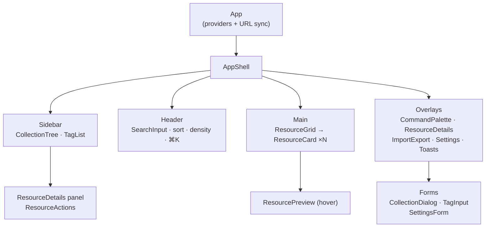
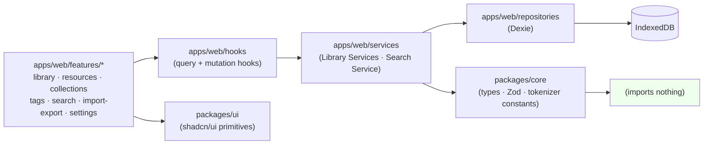
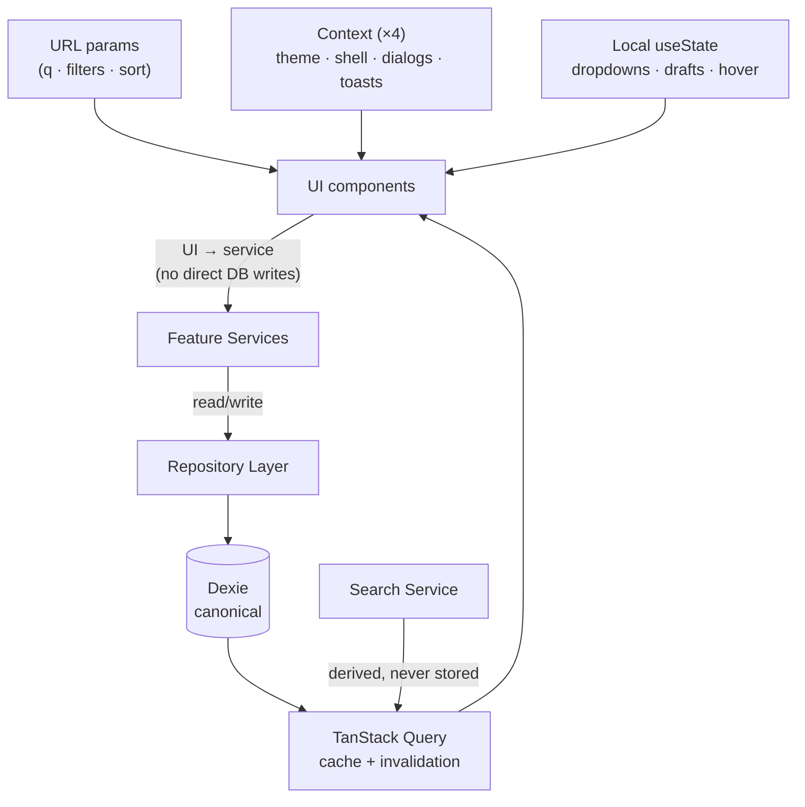
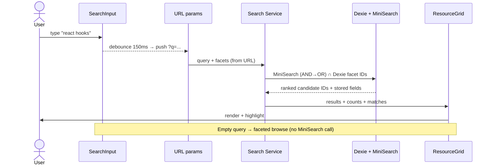

# Frontend Architecture & State Ownership — Fluid Deck

*Phase 2.5 | Status: Draft for approval | Date: 2026-11-08*
*Sources: PRODUCT_REQUIREMENTS_DOCUMENT (FR-ORG, FR-VIS, FR-SRH, FR-PRI), INFORMATION_ARCHITECTURE, SYSTEM_ARCHITECTURE (Phase 2.1), DATABASE_SCHEMA_AND_MIGRATIONS (Phase 2.2), EXTENSION_WEB_COMMUNICATION_CONTRACTS (Phase 2.3), SEARCH_AND_INDEXING_ARCHITECTURE (Phase 2.4)*

> Design-only. No components, no providers, no hooks implemented. No new dependencies — React Hook Form, Zustand, Redux, and server-state libraries are **not** introduced (ponytail: what we have is enough).

## 0. Summary

One SPA (`apps/web`), feature-folder structure, **three** state owners and no more — Dexie (canonical), TanStack Query (server-less async cache over Dexie), URL params (transient view). React Context holds four genuinely global UI concerns only. Local `useState` for everything ephemeral. This is a local-first app: there is no server, no fetch, no hypothetical API layer.

## 1. App Structure & Routing (§4)

**Routing: hand-rolled hash-free URL-param routing, one route.** The PRD/IA define a single library surface with filter state in the URL; there are no distinct pages to route to. A router library (React Router) would introduce a dependency for a one-route app. **Rejected:** React Router / file-based routing (overkill for a single-view SPA; revisit only if Phase 2.6+ grows true multi-page sections like a standalone Settings page).

- **One layout** (`AppShell`): sidebar + header/search + main + overlay stack. Everything lives inside it; dialogs/popovers are layers, not pages.
- **Sidebar:** `CollectionTree`, `TagList`, Saved Searches, Trash, Settings entry. Collapses to a top bar <768px (hamburger → overlay panel).
- **Header:** `SearchInput` (debounced 150ms), sort menu, density toggle, ⌘K button.
- **Main:** `ResourceGrid` (virtualized, 50 initial, append-on-scroll) + `SearchEmptyState` / `EmptyState` variants.
- **Overlay layer:** `CommandPalette`, `ResourceDetails` (right panel / modal), `ImportExport` (dialog with preview), `Settings` (dialog), `ResourceActions` menus, `ToastProvider` stack.
- **Deep-linking:** every filter/sort/query state is URL-encoded (FR-SRH-003) — copying the URL reproduces the view. Back/forward works because state changes are history pushes.
- **Not-found:** single fallback — unknown `collection`/tag ID in URL → clear that filter chip and show an empty-state notice (never a 404 page; this is a single-screen app).

## 2. Feature-Based Folder Structure (§5)

```
apps/web/src/
├── main.tsx                  # QueryClient + Toast providers; Dexie open; indexReady gate
├── App.tsx                   # AppShell + route-param sync (URL ↔ state)
├── components/               # AppShell, Sidebar, Header, ToastProvider, DialogStack (shared chrome)
├── features/
│   ├── library/              # Grid + card rendering (ResourceGrid, ResourceCard, ResourceTypeBadge,
│   │                         #   density, selection, virtual scroll) — owns grid state, nothing else
│   ├── resources/            # ResourceDetails panel, ResourceActions, edit form
│   ├── collections/          # CollectionTree, CollectionItem, create/rename/delete dialogs, selector
│   ├── tags/                 # TagList, TagInput (autocomplete), tag bulk ops (⌘K Tag/Merge/Rename/Delete)
│   ├── search/               # SearchInput, SearchFilters/Chips, SearchEmptyState; calls Search Service
│   ├── inbox/                # Capture Inbox bridge listener + ack sender (Phase 2.3); NO UI (feeds services)
│   ├── import-export/        # Import preview dialog, export dialog, progress + conflict modal
│   ├── settings/             # Density, purge interval, backup/reset (guarded)
│   └── command-palette/      # ⌘K fuzzy list + one-shot actions (tag/merge/delete, trash, go-to...)
├── services/                 # Library Services (Resource/Collection/Tag service fns), Search Service,
│                             #   SyncService (index invalidation), PurgeService — call Repository
├── repositories/             # Dexie repositories (one file per store, Phase 2.1 §3 src/repository)
├── hooks/                    # Query hooks (useResources, useCollections, useTags, useSearchResults),
│                             #   mutation hooks (useCreateResource...) — thin wrappers over services
├── core/                     # Types only — imports from packages/core, nothing app-specific
└── styles/                   # Tailwind v4 tokens + shadcn/ui theme
packages/core/                # Protocol types + Zod schemas + tokenizer + ranking/search constants (pure TS)
packages/ui/                  # Button, Input, Dialog, Dropdown, Tooltip, Skeleton, Badge, shadcn/ui wrappers
packages/extension-core/      # Outbox state machine (Phase 2.3) — NOT imported by web app
```

**Dependency rules (enforced by convention + lint, not tooling):** `features → hooks → services → repositories → Dexie`; `features` never imports `repositories` directly; services never import React; `core` imports nothing; `ui` imports nothing app-specific; `extension-core` never imported by `apps/web`. No cycles (Phase 2.1 §5). Empty feature folders are not created (e.g. `saved-searches/` ships with S5, not now).

## 3. Component Architecture (§6)

| Component | Responsibility | Owns data | Shared? |
|---|---|---|---|
| `App` / `AppShell` | Layout, provider stack, URL sync | None (composes) | — |
| `Sidebar` / `CollectionTree` | Navigation + collection CRUD entry | Collection query (via hook) | Feature: collections |
| `Header` / `SearchInput` | Query entry, sort menu, density | URL query param | Feature: search / settings |
| `CommandPalette` | Fuzzy jump + one-shot actions | Local filter over query results | Feature: command-palette |
| `ResourceGrid` / `ResourceCard` / `ResourceTypeBadge` | Virtualized grid; 7 type-aware card variants (FR-VIS-002 maps 8 enum values → 7 variants, U3) | Resource list query | Feature: library |
| `ResourceDetails` / `ResourceActions` / `ResourcePreview` | Detail panel, edit/delete/trash actions, hover preview | Local form state + mutation hooks | Feature: resources |
| `TagInput` / `CollectionSelector` | Autocomplete chips; multi-select membership | Tag/collection queries | Features: tags / collections |
| `SearchFilters` / `SearchEmptyState` | Active chips (removable), 0-result suggestions | URL filter state | Feature: search |
| `ToastProvider` / `DialogStack` | Global dialogs + toasts | Transient UI state | Shared chrome |

**No `ResourceList`** (grid is the primary browse mode; list would duplicate without a requirement). Generic shadcn/ui primitives live in `packages/ui`; feature-specific compositions stay in features. Components receive data via props + query hooks; **no prop-drilling beyond 2 levels** — anything deeper gets a query hook call at the leaf.

## 4. State Ownership (§7) — The Critical Section

### 4.1 Ownership matrix

| State | Owner | Notes |
|---|---|---|
| Resources, collections, tags, joins, saved searches, preferences | **Dexie / IndexedDB** (canonical) | Phase 2.2. The only persistent store |
| Resource/collection/tag list reads, search results, mutations | **TanStack Query** over Dexie | Cache keyed by semantic query key (`["resources", filters]`); mutations invalidate keys; no server involved |
| Theme (light/dark), shell (sidebar open), global dialog stack, toasts, **command palette open** | **React Context** (4 small providers, not one) | Genuinely global UI concerns only |
| Query, filters, selected collection, sort (per-view persisted pref lives in `preferences` — Phase 2.2 D3) | **URL params** | Transient view state; shareable/bookmarkable (FR-SRH-003) |
| Dialog open/closed, dropdown open, hover, form drafts, grid selection, debounce timers | **Local `useState`** | Ephemeral by nature |
| Filtered/sorted results, facet counts, highlighted matches | **Derived** (Search Service) | Never stored |

### 4.2 Anti-patterns (explicitly prohibited)
Duplicating Dexie data in Context · storing search results as canonical data · keeping URL filters in global state · multiple sources of truth for one entity · prop-drilling past 2 levels · a single global "app state" Context · writing directly to IndexedDB from components (all writes go `UI → service → repository → Dexie → invalidation`).

## 5. Data Flow & Mutations (§8)

`UI → Feature Service → Repository → Dexie commit → TanStack invalidation → UI update.` Search synchronization hangs off the same post-commit invalidation (Phase 2.4 — drafts never indexed before commit).
- **Optimistic updates:** create/edit/delete UI affordances *may* optimistically update the grid *after* the Dexie write is initiated but before invalidation; this is safe because Dexie writes are local and fast (<1ms for point writes), with rollback-on-failure via TanStack's mutation error path. **Exception (wait for commit):** import batches (500-row) and full-delete/reset — always wait, never optimistic.
- **Extension capture:** Inbox bridge listener → validate → service → Repository → ack (after commit, Phase 2.3). UI never sees the bridge.
- **Multi-select/bulk actions:** mutations fan out through services; each invalidates once at completion (not per-row).

## 6. Forms & Validation (§9)

**No React Hook Form.** Forms are small (resource edit, collection create, tag input, settings) — controlled inputs + Zod validation at submission (`packages/core` schemas; Phase 2.3/2.5 boundary = same Zod schemas, single-sourced). No `react-hook-form` dependency: the library solves uncontrolled-form complexity we don't have. Examples: Resource edit (controlled title/desc/notes + type override, dirty-check on close-warning); Collection create (Zod: non-empty name, optional parent ≤3 levels w/ warning at 4 — U2); Tag input (autocomplete from `tags` usage-ranked, comma/Enter → chip, dup → no-op); Settings (density radio, purge interval select, reset guarded by type-to-confirm). Inline errors on submit + field-level messages; dirty state tracked in local state.

## 7. Design System (§10)

- **Tokens (Tailwind v4 `@theme`):** spacing scale 4px base; radius `rounded-lg` surfaces / `rounded-full` chips / `rounded-md` inputs; type scale: `text-sm` cards, `text-base` body, `text-lg` titles; surfaces: `background → card → elevated → overlay` (z/elevation steps); borders: 1px subtle, skip decorative borders.
- **Color:** neutral zinc-based palette + single accent; light theme default, dark theme via `class` strategy on `<html>` (Context-owned, persisted in `preferences`).
- **Focus:** visible 2px ring on every interactive element; dialogs trap focus and return it on close.
- **Icons:** Lucide (shadcn/ui default) — no emoji, no icon set proliferation.
- **Motion:** CSS transitions only (150–200ms ease-out); no animation library. `prefers-reduced-motion` disables transitions.

## 8. Responsive & Accessibility (§11)

Desktop full 3-zone shell (sidebar + header + grid); <768px sidebar → overlay panel, grid → single column, header search full-width. Grid columns: auto-fit minmax, clamped 1–6. Dialogs: max-width, scrollable, close on Esc, focus trap. Keyboard: ⌘K palette, `s` sort menu, full sidebar nav by keyboard, visible focus everywhere. Semantics: proper landmarks (`nav`, `main`, `dialog`), `aria-label` on icon buttons, chips as buttons with labels, live-region for toasts and search results count. Reduced motion respected. Contrast target WCAG 2.2 AA. *Architecture defines the contracts (landmarks, focus rules); visual QA and screen-reader testing are Phase 4 implementation checks.*

## 9. Loading, Empty, Error & Feedback States (§12)

Single consistent pattern: **skeleton → content / named empty state / named error**, never a blank flash. Initial DB load: skeleton grid behind "Indexing…" gate (Phase 2.4). Empty library → Import CTA; empty collection → "save or drag here"; no results → FR-SRH-007 suggestions (broaden, spelling, import); DB unavailable → banner + Restore from backup; import → progress bar per batch + per-conflict modal; capture pending → badge count + popup copy ("Saved to outbox — opens on next launch"), success toast once, failure → dismissible error (no toast spam). Destructive actions (delete resource, delete collection, reset) always go through confirm dialogs; reset additionally requires typed confirmation + JSON backup offer.

## 10. Testing Architecture (§13)

- **Vitest (core/services):** tokenizer, dedup/canonicalization, outbox state machine, service logic — pure, no DOM.
- **Vitest + React Testing Library (features):** component behavior (cards render type-aware fields, chips remove filters, dialogs open/close), service-hook integration with fake-indexeddb.
- **Playwright (e2e):** critical journeys only — first-run import → search → organize; capture → ack (with a fake app tab); trash/restore; export→re-import round-trip; full delete. No exhaustive per-element clicking.
- **Accessibility:** automated checks (`axe`-style role/label assertions in Vitest) + manual screen-reader pass at Phase 4. No test *execution* is claimed in Phase 2.5.

## 11. Decisions, Risks & Traceability (§15)

**Decided:** single-route URL-param routing (vary the URL, not the router); 3 state owners (Dexie / TanStack / URL) + 4 small Contexts; no React Hook Form; no new libraries; grid-only (no list view).
**Rejected:** React Router (one route), Zustand/Redux (Context + Query suffice), RHF (forms too small), persisted search results, list view.
**Risks:** Context proliferation → cap at 4 providers by policy; URL-param sprawl → single `ViewState` Zod schema in `core`; TanStack misuse as a server-cache habit → invalidation key discipline documented here.
**Phase 2.2 U1–U6 carried forward unchanged** (U2 collection depth surfaces as a create-form warning; U3 8→7 card variant mapping noted in §3).
**Traceability:** FR-ORG-* → collections/tags features · FR-VIS-001–005 → library grid, cards, density, selection · FR-SRH-001–007 → search feature + URL state + empty states · FR-PRI-001–003 → zero telemetry (no analytics deps), full delete (guarded), no auth screen · Phase 2.1 §§3/5 (services/repositories) · Phase 2.2 (URL-transient view state, D3) · Phase 2.3 (Inbox module boundary) · Phase 2.4 (Search Service ownership) ✓.

## 12. Required Diagrams

### 12.1 Frontend component hierarchy


### 12.2 Feature-based package & module dependencies


### 12.3 State ownership & data flow


### 12.4 Resource mutation lifecycle
```mermaid
sequenceDiagram
    actor User
    participant UI as UI component
    participant Svc as Feature Service
    participant Repo as Repository
    participant DB as Dexie
    participant Q as TanStack Query
    User->>UI: edit / delete / tag / move
    UI->>Svc: mutation intent
    Svc->>Repo: write (single Dexie tx)
    Repo->>DB: commit
    DB-->>Svc: committed
    Svc->>Q: invalidate affected keys
    Svc->>Svc: index sync (Phase 2.4, post-commit)
    Q-->>UI: re-render with fresh data
    Note over UI,Q: Optimistic UI allowed for point updates;<br/>imports & full-delete always wait for commit
```

### 12.5 Search interaction lifecycle

