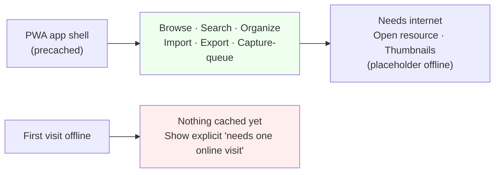
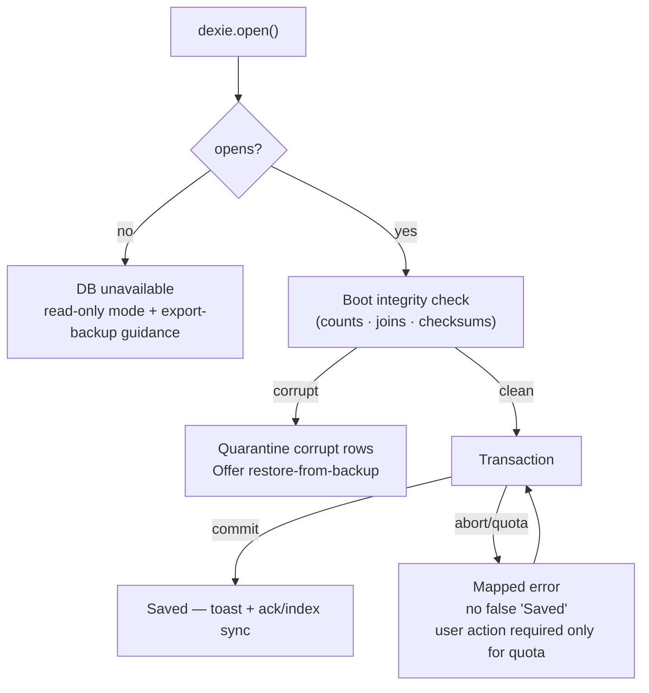
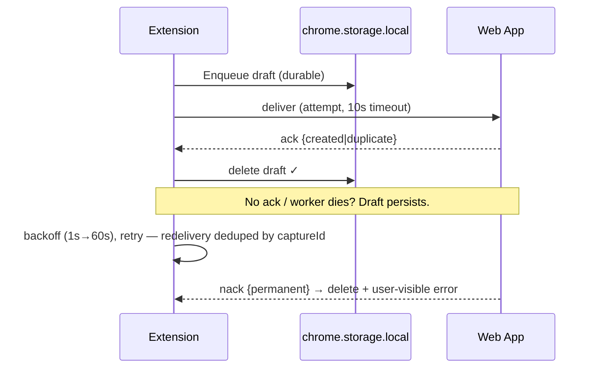
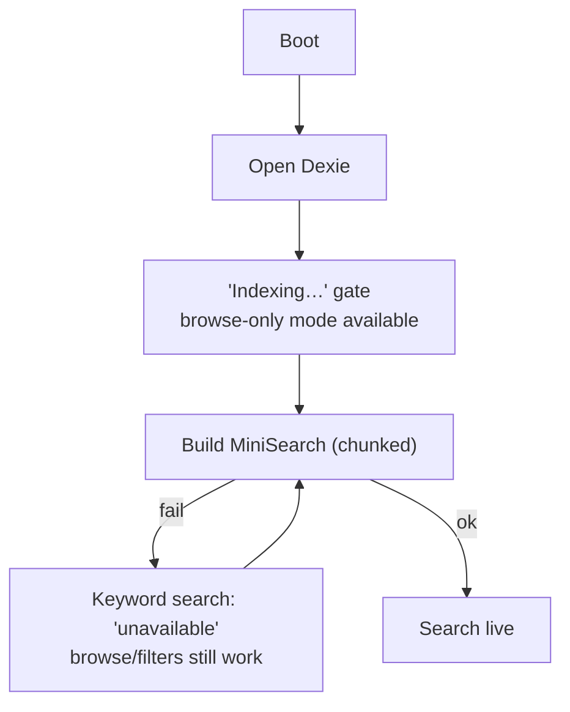
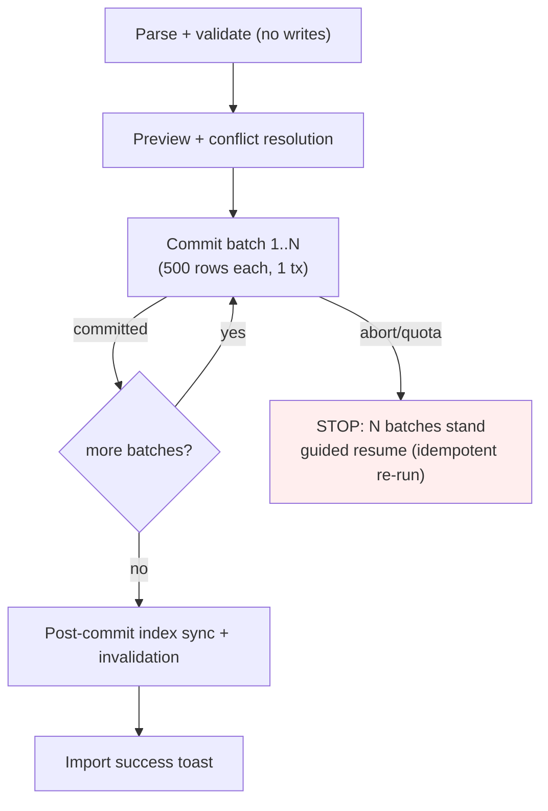

# Offline Behavior, Reliability & Error Handling — Fluid Deck

*Phase 2.6 | Status: Draft for approval | Date: 2026-11-08*
*Sources: PRODUCT_REQUIREMENTS_DOCUMENT (FR-STO-008, FR-PRI-001–003), SYSTEM_ARCHITECTURE (Phase 2.1), DATABASE_SCHEMA_AND_MIGRATIONS (Phase 2.2), EXTENSION_WEB_COMMUNICATION_CONTRACTS (Phase 2.3), SEARCH_AND_INDEXING_ARCHITECTURE (Phase 2.4), FRONTEND_ARCHITECTURE_AND_STATE_OWNERSHIP (Phase 2.5)*

> Design-only. No service workers, no retry code, no recovery handlers. **All reliability guarantees are documented thresholds and classifications, not code.**

## 0. The one invariant (read first)

**Dexie is canonical and single-writer; a user is only told "saved" after a Dexie transaction commits.** Every reliability decision below exists to defend this one sentence. Confusing "queued" (extension outbox) with "saved" (commit) is the system's central failure mode; every layer names it explicitly.

## 1. Offline-First Boundaries (§4)

| Capability | Offline | Why |
|---|---|---|
| Browse, search, filter, sort, edit notes/tags/collections | ✅ Full | All local (IndexedDB + in-memory MiniSearch) |
| Import/export (files) | ✅ Full | Files are local; no network involved |
| Capture via extension (queued state) | ✅ Full | Outbox in `chrome.storage.local` |
| Extension capture *acknowledged* (needs web app open) | ✅ Local — app tab is local | Bridge is local-only; "offline" only matters for thumbnails |
| Resource navigation / thumbnails | ❌ | External HTTP fetch — degrades to placeholder; app must not block |
| **First visit while offline** | ❌ (explicit limitation) | Nothing cached yet — service worker can only serve what was previously fetched. Honest, documented, not a bug. |

**PWA caching (minimal):** service worker caches **app shell only** (HTML, JS, CSS, fonts — precached, versioned, updated on deploy). No runtime caching of extracted content. This is the smallest strategy that makes "subsequent visits offline" work; runtime caching adds stale-content risk for zero MVP benefit. **Capability table is the UX contract:** users know exactly which buttons need the network (only "Open" and thumbnails).

## 2. IndexedDB & Dexie Reliability (§5)

**What IndexedDB transactions guarantee:** atomicity (all-or-nothing), isolation (no interleaving from other tabs while in-flight), durability *once committed* (survives browser crash/restart, subject to storage eviction policies).
**What they do not:** protection against storage eviction, guaranteed disk space, cross-database atomicity (import batches are separate transactions by design — §5.3), or integrity of data *before* the first commit.

**Failure→response map:**

| Failure | Detection | User sees | Retry safe? |
|---|---|---|---|
| DB open failure / version mismatch | `dexie.open()` rejection | "Database unavailable — try again / export backup" (never auto-delete); app enters read-only mode, reads still work where possible | Only user-initiated retry after fixing space/version state |
| Transaction abort / constraint | `ConstraintError` / `AbortError` | Mapped error (below); **no "Saved" toast** | Create/edit: safe to retry the whole operation; partial state impossible (single tx) — this is the atomicity guarantee doing its job |
| Blocked upgrade (another tab holds old version) | `blocked` event | "Another Fluid Deck tab is open — close it to upgrade" (dialog, not a crash) | Resume when the tab closes; upgrade is atomic, half-upgrade state impossible |
| Browser shutdown mid-transaction | N/A (resume see post-commit state) | On next boot, the write is either present or absent — never partial | Idempotent: safe to re-issue; ambiguity is resolved by canonicalUrl/captureId idempotency, not by guessing (Phase 2.3) |
| Multi-tab concurrent writes | IndexedDB serializes transactions | Writes queue; last-commit-wins for same-row fields (single-user MVP — no merge machinery) | Safe; UI refreshes via invalidation |
| Storage eviction | Invisible until it happens → boot integrity check catches missing DB | "Data sharing/storage issue detected" → Restore from JSON backup, read-only mode | User-initiated restore only; **never automatic** |
| Private browsing / storage disabled | `dexie.open()` rejection at boot | "Storage unavailable in this browser mode" | Requires user action (exit private mode) |
| Quota exceeded | `QuotaExceededError` at write | Blocking modal: "Storage full. **Export backup, then delete** to resume" (PRD §11 error UX) | Required user action; nothing auto-deleted |
| Corrupt/missing records | Boot integrity check (counts + join sweep + spot checksums, FR-STO-008) | "Corruption detected. Restore from backup?" — corrupt rows **quarantined** (excluded from search/grid), rest of library usable | Restore via import; quarantine is never silent |

**Recovery NEVER auto-deletes the database.** The only destructive path is the guarded full-delete (type-to-confirm, export-first prompt, Phase 2.2 §3.4). Every other recovery is read-only quarantine + user-guided restore.

## 3. Extension Queue Reliability (§6)

Per Phase 2.3 (carried forward as **proposals, not approved constants**): ack timeout 10s, backoff 1s→60s, unbounded retry, drafts deleted only on ack.
- **State machine:** `queued → inflight (deliver sent) → awaiting-ack` (timeout→`queued`, attempts++) → `acked→deleted` | `nack-permanent→deleted+surfaced` | `nack-retryable→queued (backoff)`.
- **Service-worker termination / browser restart:** outbox (`chrome.storage.local`) is the state; background memory is disposable. On wake: re-scan outbox, resume timers by `attempts/lastAttemptAt`.
- **Lost ack:** redelivery → Inbox resolves as duplicate → `{outcome:duplicate}` → cleanup. Exactly-once *resource creation* comes from idempotency, never from the transport (Phase 2.3 §5).
- **Permutation safety:** a draft is distinguishable only by `captureId`; the extension never creates a second draft for the same capture.
- **Quota exhaustion at enqueue:** refuse at write time with a clear error — never silently drop, never create a second copy elsewhere.
- **Corrupt outbox entry (Zod/JSON failure):** mark as permanently failed on first validation error, surface "Couldn't save N captures", **delete only after user acknowledges** the error dialog (user choice, not a timer). Never silently discard.
- **Visibility:** badge count = outbox size; popup shows "Saved" (acked) vs "Queued" (draft pending) — never conflated.

## 4. Search Index Reliability (§7)

Per Phase 2.4 (rebuilt every start, in-memory only). **Failure posture:** "Indexing…" state; library remains browsable in **browse-only degraded mode** (filters/sort still work via Dexie facet queries — keyword search shows "Search unavailable — indexing" rather than a blank result set). No persisted MiniSearch storage, no SQLite fallback, no attempt to salvage a stale present-in-memory index after corruption — rebuild is always the recovery. Resources are never at risk because the index is disposable.

## 5. Import & Export Reliability (§8)

**Import lifecycle (failure-safe):** parse (no writes) → preview (counts + conflicts, no writes) → user resolution → commit in **500-row batches** (each batch = one Dexie tx; atomic per batch). Any batch failure (quota, malformed record, shutdown) aborts the import *at that batch*: previous batches stand, user is told exactly how many committed; re-running is idempotent (canonicalUrl dedup). **Import never reports success unless all batches committed;** failure → guided message ("Import paused at N of M — export-then-delete for space / fix file / retry") with no partial-batch ambiguity and no tracking table (Phase 2.2 D2 — tracking is not justified). **Export:** read-only snapshot (consistent TanStack read transaction), never writes; interruption is harmless (download simply doesn't complete); failures surface as download errors, not data loss.

## 6. Storage Quota & Data Protection (§9)

- **Telemetry:** `navigator.storage.estimate()` (quota/usage) checked at write time and surfaced in… nothing automatic. No thresholds invoke telemetry (FR-PRI-001: zero telemetry — no analytics, crash reporting, or usage tracking unless explicit opt-in).
- **Persistence request:** `navigator.storage.persist()` called once at first run; its result is *informational only* — persisted per *browser policy*, revocable by the user or the browser under storage pressure. Documented as such; **no promise that persisted data can never be deleted.**
- **Degradation path (quota warning → quota exceeded → eviction):** quota warnings are UI-level (banner); quota exceeded blocks writes with export-first guidance (§2); eviction is detected at boot (missing/corrupt DB → restore flow). **No automatic deletion of user resources ever** — thumbnails are URL-only (Phase 2.2/2.1), so library size is the user's real usage, not a system leak.
- **Backup as the only true protection:** JSON export is the portability/backup path (FR-PRI-002). Export-before-destructive-action is prompted (not forced) on reset/full-delete; persistence ≠ backup is stated in the UI copy at Settings.
- **U5 carried forward unchanged:** 30-day soft-delete purge interval remains a Phase 2.2 open decision; 30 days is a default, not yet a product approval; **not implemented here.**

## 7. Error Taxonomy (§10)

One `FluidDeckError` shape (`category, code, userMessage, recovery`) flows from Repository → Service → TanStack Query (error state) → React component (rendered message). No raw stack traces, no internal paths, no user content in UI messages. **Categories and recovery:**

| Category | Example | User message | Retry? | Logging |
|---|---|---|---|---|
| Validation | Oversized draft, bad URL scheme | "This capture couldn't be saved (details)" | **Permanent** → discard+surfaced (§3) | In-memory ring buffer only, no upload |
| User input | Empty collection name | Inline field error | N/A | — |
| Database | Open failure, tx abort | "Database unavailable / backup restore" | Retryable (except version mismatch → user action) | Local log |
| Quota | `QuotaExceededError` | Export-then-delete modal | **Blocked** until space | — |
| Search/index | MiniSearch failure | "Search unavailable — indexing" | Automatic (rebuild on next boot) | Local log |
| Extension comms | Ack timeout, version mismatch | "Captured — pending" / "incompatible versions" | Backoff retry, no nagging UI | Badge-count only |
| Import/export | Malformed file, dup conflict | Preview/conflict modal | User-guided resume | — |
| Browser compat | Missing API (old browser) | "This browser isn't supported" gate | — | — |
| Unexpected | Null ref, uncaught | Error boundary: "Something went wrong" **plus** actionable recovery (export backup / reload) — never a bare message | Reload | Local error boundary catch, no upload |

**One global error boundary** in React catches render crashes → recovery screen with "Export backup", "Reload", "Reset (guarded)". **Zero telemetry:** "logging" in the table means an in-memory ring buffer the user can inspect — nothing leaves the machine.

## 8. Multi-Tab (§11)

- **No leader election, no distributed locks.** Concurrent tabs are acceptable: IndexedDB serializes transactions; last-commit-wins on same-row fields.
- **Cross-tab update propagation:** invalidation cascades via the same TanStack Query invalidation used by single-tab mutations, plus a `BroadcastChannel`-free fallback (storage event? No — deliberate absence: cross-tab live sync is a nicety, not an MVP requirement. Each tab re-queries on navigation back — stale data corrects itself on interaction.).
- **Version upgrade while a tab is open:** Dexie `blocked` event → "close other tabs" dialog (§2) — the only multi-tab UX.
- **Multiple index rebuilds:** each tab builds its own in-memory index — harmless, CPU cost only, no shared state to corrupt.

## 9. Reliability Testing Strategy (§13)

Vitest (service/repository level, `fake-indexeddb`): transaction failure/rollback, quota exhaustion (stub `storage.estimate`), version upgrade + blocked-upgrade, outbox state transitions + simulated ack loss + duplicate delivery, search rebuild after corruption (in-memory index never persisted by design), import batch rollback. Playwright (e2e): cold boot → build → search; capture → ack; multi-tab concurrency (two flows write simultaneously); offline browse after PWA precache; full delete after export. `window.matchMedia`/`storage` stubs for browser-compat gates. **Documented scenarios are design intent; hypothetical failures will need Phase 4 implementation to verify — no tests were run in Phase 2.6.**

## 10. Required Diagrams

### 10.1 Offline & online capability boundaries


### 10.2 IndexedDB transaction failure & recovery


### 10.3 Extension outbox retry & recovery


### 10.4 Search index failure & rebuild


### 10.5 Import transaction & rollback


## 11. Decisions, Risks & Traceability (§15)

**Decided:** PWA app-shell-only caching; quarantine-not-delete; never-auto-destructive recovery; 30-day purge **unchanged** (U5); outbox as sole retry state.
**Alternatives rejected:** persistent MiniSearch cache (rebuild is cheaper than cache coherence); service-worker runtime caching (stale-content risk); distributed multi-tab locking (overkill); automatic DB repair/deletion (data-loss vector); cloud/remote backups (out of MVP scope and zero-telemetry principle).
**Phase 2.2 U1–U6 carried forward unchanged** (U5 purge, U2 depth, U6 naming — still open; Phase 2.3 retry values remain **proposals**).
**Traceability:** FR-STO-007/008 (soft delete/integrity → §2) · FR-PRI-001/002/003 (zero telemetry, full delete with verification, no auth → §§6–7) · PRD §11 error UX (quota/corruption modals → §§2,6) · Phase 2.1 §10 (Zone A failure table) · Phase 2.2 §§3–4 (migration/transaction integrity) · Phase 2.3 §§5–6 (outbox/nonces) · Phase 2.4 §§6–7 (disposable index, degraded mode) · Phase 2.5 §§9,12 (states, error boundary) ✓.

```text
*Verification status: all 14 items in brief §13 checked. No tests/benchmarks run (documentation only).*
```
