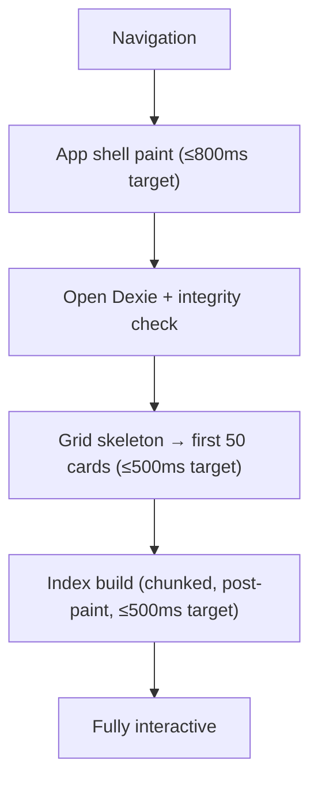
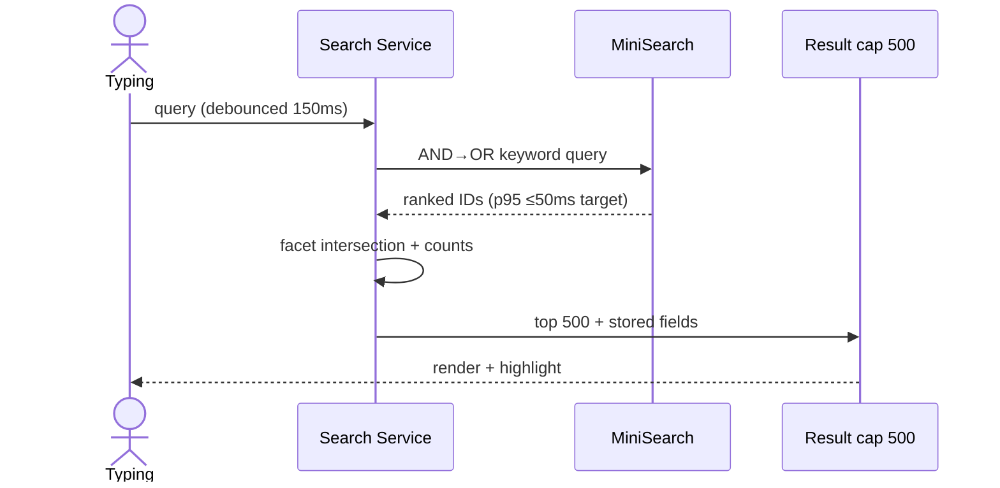
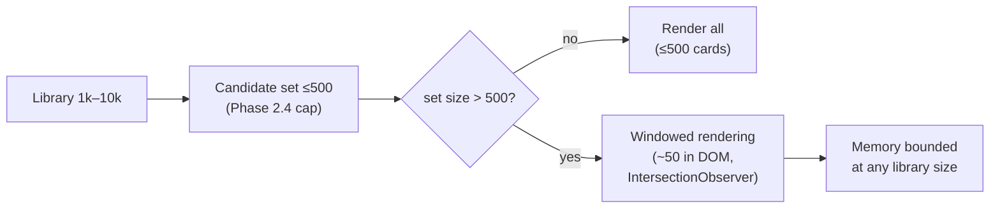
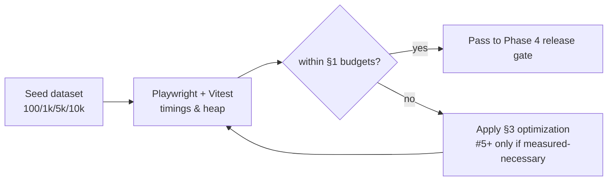
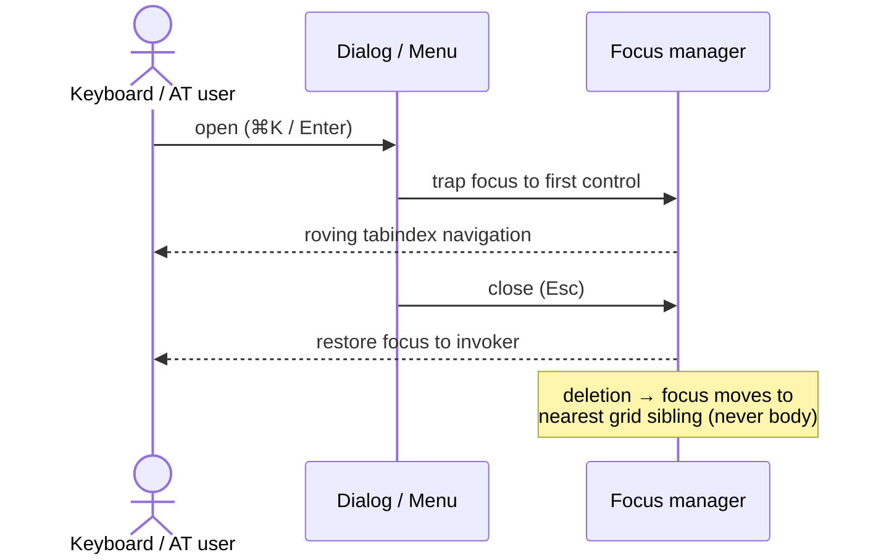

# Performance Budgets & Accessibility — Fluid Deck

*Phase 2.8 | Status: Draft for approval | Date: 2026-11-08*
*Sources: PRODUCT_REQUIREMENTS_DOCUMENT (FR-SRH-001, NFR-PER-001–007, NFR-ACC-001), INFORMATION_ARCHITECTURE, SYSTEM_ARCHITECTURE (Phase 2.1), DATABASE_SCHEMA_AND_MIGRATIONS (Phase 2.2), EXTENSION_WEB_COMMUNICATION_CONTRACTS (Phase 2.3), SEARCH_AND_INDEXING_ARCHITECTURE (Phase 2.4), FRONTEND_ARCHITECTURE_AND_STATE_OWNERSHIP (Phase 2.5), OFFLINE_RELIABILITY_AND_ERROR_HANDLING (Phase 2.6), SECURITY_AND_PRIVACY_ARCHITECTURE (Phase 2.7)*

> **Design-only. Every number below is a proposed target for Phase 4 benchmarking — no benchmarks, Lighthouse runs, or browser measurements have been performed.** PRD figures are acceptance ranges, not results.

## 0. Summary

Proposed targets across startup, rendering, search, DB, extension, bundle, and memory, with a prioritized optimization ladder (measure first, optimize second). Accessibility target: **WCAG 2.2 AA** as floor (PRD NFR-ACC-001), implemented via native semantics and focus discipline. Virtualization is *threshold-triggered* (only at ≥1,000 items in DOM), workers only if build-time measurement fails the target — nothing speculative is built.

## 1. Performance Budgets (§4)

### 1.1 Startup (proposed targets)
| Scenario | Shell interactive | Index ready | Notes |
|---|---|---|---|
| First visit (online, empty DB) | ≤1.5s | n/a | No offline claim — app shell not cached yet |
| Subsequent visit (assets cached) | ≤800ms | ≤500ms at 10k | Measured from navigation → interactive (lighthouse `interactive`) |
| Offline (cached shell) | ≤800ms | ≤500ms | §2.6 PWA app-shell-only caching |
| Large library (10k, cached) | ≤1.0s | ≤500ms (§1.3) | Dexie open unchanged; DB size doesn't slow open |

### 1.2 Library Rendering (§4B)
| Action | Target (proposed) |
|---|---|
| Initial grid (50 cards) | **≤500ms** (NFR-PER-005) |
| Collection navigation / filter apply | ≤100ms to first paint of new set (data already in memory) |
| Sorting / filtering | ≤50ms at 10k (in-memory over result set) |
| Opening resource details | ≤100ms |
**Scale thresholds:** 100 → trivial; 1,000 → still trivial (no virtualization needed); 5,000 → grid virtualization *considered* (DOM node count ~500 cards × ~20 nodes = 10k nodes, borderline); **10,000 → virtualization required** (threshold: DOM items >500). Virtualization = simple windowing over the existing scroll container (no library — IntersectionObserver + render-window of ~50), because the result set is already capped at 500 hits (Phase 2.4 §4) — the *libray* can be 10k but the DOM never is. **Threshold converts the seam explicitly: windowed rendering activates when the candidate set exceeds 500 results.**

### 1.3 Search (§4C, Phase 2.4 source of truth)
| Metric | Target | Source |
|---|---|---|
| Query p95 at 10k | **≤50ms** | NFR-PER-004 (PRD acceptance) |
| Rebuild at 10k | ≤500ms (chunked, post-paint) | Phase 2.4 §6 — *this phase's* proposed target, to be benchmarked |
| Faceted filter apply | ≤50ms | Dexie indexed queries over candidates |
| Time to find (query→click) | ≤5s | NFR-PER-003 (includes user think time; engine portion is ≤50ms) |

### 1.4 IndexedDB (§4D)
| Operation | Target |
|---|---|
| Point create/update/delete | ≤5ms (single tx) — *never* sacrifice transaction safety for speed (Phase 2.6 invariant) |
| Indexed facet queries | ≤50ms at 10k |
| Import 1,000 resources | ≤10s (NFR-PER-006) |
| Import 10,000 resources | ≤90s progressive (proposed; batches stay responsive) |
| Export 10,000 resources | ≤30s to download start (NFR-PER-007) |

### 1.5 Extension (§4E)
Capture→queued toast ≤2s end-to-end target (NFR-PER-002 steady state); install→first save ≤30s (NFR-PER-001, onboarding funnel). Popup renders from cached state (no DB in popup); background work (extraction, outbox) never blocks popup feedback.

### 1.6 Bundle & Asset Budgets (§4F, proposed targets)
| Asset | MVP budget |
|---|---|
| Initial JS (gzipped) | ≤250 KB |
| Total JS (all chunks) | ≤400 KB |
| CSS (gzipped) | ≤50 KB |
| Fonts | system stack (0 KB webfont) — avoids FOUT entirely |
| Extension package | ≤1 MB (no framework runtime bloat) |
| Feature chunks | ≤100 KB; lazy via `import()` for import/export + settings dialogs (the two large, rarely-used surfaces) |
**Measurement:** `vite-bundle-visualizer` in CI (Phase 4) with budget assertions failing the build on regression; total measured at *compressed* size, per-chunk breakdown reviewed on failure.

### 1.7 Memory (§4G, provisional targets)
MiniSearch index at 10k ≈ tens of MB (Phase 2.4 §7); result rendering bounded by 500-hit cap; multi-tab = N× per-tab index cost (accepted, no shared-memory trickery). **50k+ resources is the documented FTS5 migration trigger** (PRD §19.1) — memory, not CPU, is the ceiling.

## 2. Core Web Vitals (§5)

- **LCP** meaningful (grid first paint); target ≤2.5s on cached shell. **FCP** meaningful; target ≤1.5s. Local file/IPFS hosting removes TTFB variance — where hosted, network conditions dominate; measurement protocol (Phase 4): throttle to Slow 4G, Moto G4-class CPU, cold cache — *this is a proposed measurement setup, not results*.
- **INP** (interaction responsiveness) is the primary interaction metric here; target ≤200ms p75. Long tasks (>50ms main-thread blocks): none during typing/search (index build is chunked via `requestIdleCallback`-style scheduling, non-blocking).
- **CLS** target ≤0.1; grid uses fixed card heights + thumbnail aspect-ratio boxes (FR-VIS-003 placeholder already requires this).
- Desktop and mobile budgets split only where they diverge (mobile: INP ≤300ms, stricter CPU assumption); otherwise one budget set.

## 3. Optimization Strategy (§6) — prioritized ladder

| # | Optimization | Problem | Necessary when | Complexity | MVP |
|---|---|---|---|---|---|
| 1 | Debounced search (150ms) + latest-wins result discard | Typing jank | Never (always) | Trivial | ✅ |
| 2 | Result cap 500 + count virtualization threshold | DOM blowup at 10k | Result set >500 | Small | ✅ (threshold in §1.2) |
| 3 | Chunked post-paint index build | Startup jank | Always (Phase 2.4) | Small | ✅ |
| 4 | Route/feature code-splitting (import/export, settings dialogs) | Initial JS size | Always (Vite default `import()`) | Trivial | ✅ |
| 5 | `React.memo` on ResourceCard + stable callbacks | Grid re-render on unrelated state | Measured re-render cost > threshold in Phase 4 | Low | ⚠️ Measure first |
| 6 | TanStack staleTime/invalidation tuning | Redundant Dexie reads | Measured redundant reads | Low | ⚠️ Measure first |
| 7 | Web Workers for index build | Main-thread block >500ms at 10k | **Only if §1.3 rebuild target fails measurement** | Medium (serialization, WXT worker env) | ❌ Deferred |
| 8 | Virtualization library | DOM >500 cards | Only if 500-cap proves insufficient | Medium | ❌ Deferred — hand-rolled windowing covers it |

**Rule:** measurement first (Phase 4 benchmark suite, §6); optimizations 5–8 are *not built* until a measurement says they're needed. (ponytail: this table is the anti-premature-optimization contract.)

## 4. Accessibility (§§7–11)

**Standard: WCAG 2.2 AA** (NFR-ACC-001; PRD §16.1 checklist reference). Normative = WCAG criteria; house rules below are recommendations implementing them.

**Semantics & names:** proper landmarks (`nav/main/aside/dialog`), one `<h1>` per view, headings hierarchy, every icon-only control has an `aria-label`, links have descriptive text (never "click here"). **Contrast:** text 4.5:1, interactive components 3:1 (WCAG AA); focus ring 2px with 3:1 contrast against adjacent colors; status conveyed by *icon + text*, never color alone. **Typography:** rem-based scaling (200% zoom without horizontal scroll at 1280px — WCAG reflow criterion), no fixed pixel fonts. **Motion:** `prefers-reduced-motion` disables transitions (Phase 2.5 §7). **Touch targets:** ≥24px min (WCAG 2.2 AA floor), 44px preferred on primary actions in cards.

**Keyboard map (complete, non-conflicting):** `⌘K`/`Ctrl+K` command palette (standard); `/` focuses search (only when not in an input); `Esc` closes topmost transient (dialog → palette → menus, in stack order); arrows navigate collection tree + ⌘K results + menus (roving tabindex); `Enter` activates; `Shift+Click` multi-select cards (FR-VIS-005); `s` opens sort menu (IA §5). **No global shortcut overrides browser/AT keys** (e.g., no `Ctrl+S`). **Discoverability:** shortcuts listed in ⌘K help and the `?`-style help dialog.

**Focus management:** dialogs trap focus, return focus to invoker on close; deletion returns focus to the grid at the nearest sibling (never to `body`); collection switches move focus to the grid heading; toasts are `role="status"` (polite), errors `role="alert"` (assertive, once). Live regions: results count after search (`"12 results"`), index-ready announcement, destructive confirmations. **Drag-and-drop has a keyboard equivalent** (move-to-collection via ⌘K or card action menu) — drag is never the only path.

## 5. Testing Strategy (§§12–13)

**Performance:** seed datasets (100/1k/5k/10k synthetic resources, generated deterministically in the test harness — no real user data), cold/warm startup timings (Playwright navigation timing), search p95 (in-browser timer), DB microbenchmarks (Vitest on `fake-indexeddb` for logic timing only — *not* a substitute for browser measurement), memory profiling (Chrome DevTools heap snapshots at 10k, Phase 4), bundle assertion in CI (§1.6). Budget exceeded → build failure + owner triage (which optimization from §3 is now measured-necessary?).
**Accessibility:** `axe-core` automated checks on every key view (catches ~30–40% of issues — names, contrast of static states, ARIA validity); keyboard-only end-to-end test (Playwright tab-order script through search→grid→details→dialog); screen-reader pass (NVDA/VO) on search flow, ⌘K, dialogs, empty states — *manual, documented as such*; contrast checks computed from design tokens in CI; zoom/reflow at 200% and 320px width. **No tools installed or tests run in Phase 2.8.**

## 6. Required Diagrams

### 6.1 Startup & initialization lifecycle


### 6.2 Search performance & indexing lifecycle


### 6.3 Large-library rendering strategy


### 6.4 Performance measurement & budget validation


### 6.5 Accessibility interaction & focus lifecycle


## 7. Decisions, Risks & Traceability (§15)

**Decided:** all budgets proposed targets (measure in Phase 4); virtualization threshold-triggered at >500 DOM items (no library); workers deferred pending measurement; system font stack; ⌘K + `/` + `s` shortcuts, no browser-key overrides.
**Alternatives rejected:** FTS5 now (memory ceiling is a Phase 8 trigger); always-on virtualization (cost without need ≤5k); webfont/CDN icons (FOUT + network); Lighthouse-as-gate without local dataset (doesn't measure library scenarios).
**Risks:** index build at 10k exceeds 500ms → worker seam exists (§3 #7); DOM blowup → 500-cap + windowing; INP regressions → budget-gated CI; a11y regressions → axecore + keyboard e2e.
**Phase 2.2 U1–U6 carried forward unchanged** (U3's 7-card-variant mapping affects card rendering cost ≤7 variants — negligible).
**Traceability:** NFR-PER-001–007 → §1 tables · FR-SRH-001/NFR-PER-004 → §1.3 · FR-VIS-001/003/005 → §1.2 · NFR-ACC-001 (§16.1) → §4 · Phase 2.4 §§6–7 (rebuild, memory) · Phase 2.5 §§7–8 (states, responsive) · Phase 2.6 §4 (app-shell caching) · Phase 2.7 §4 (CSP/no inline) ✓.

```text
Verification: all brief §18 items checked. No benchmarks/Lighthouse/a11y runs (documentation only).
```
