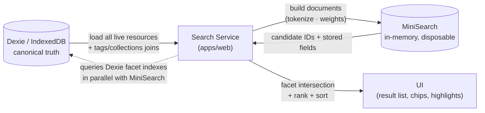
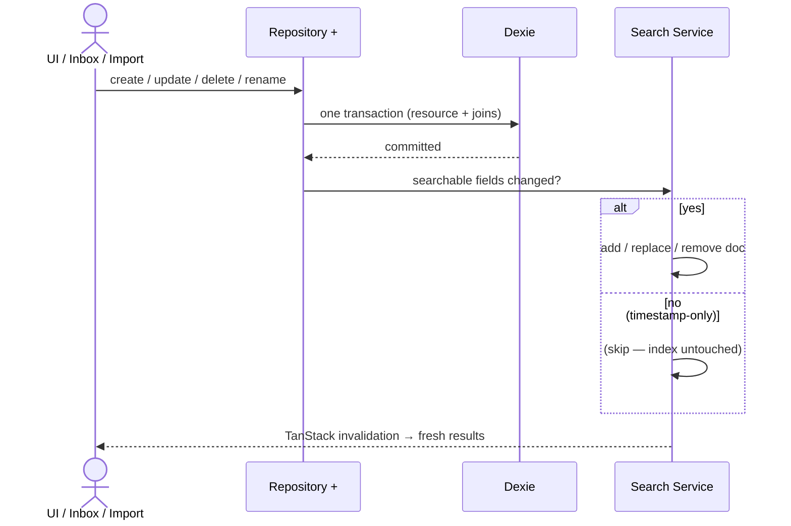
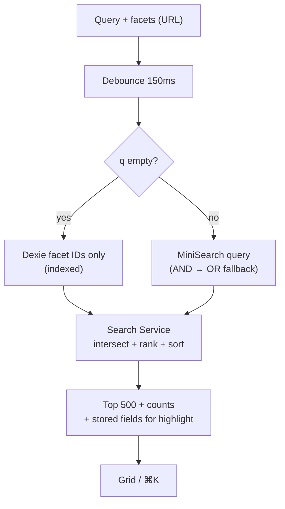
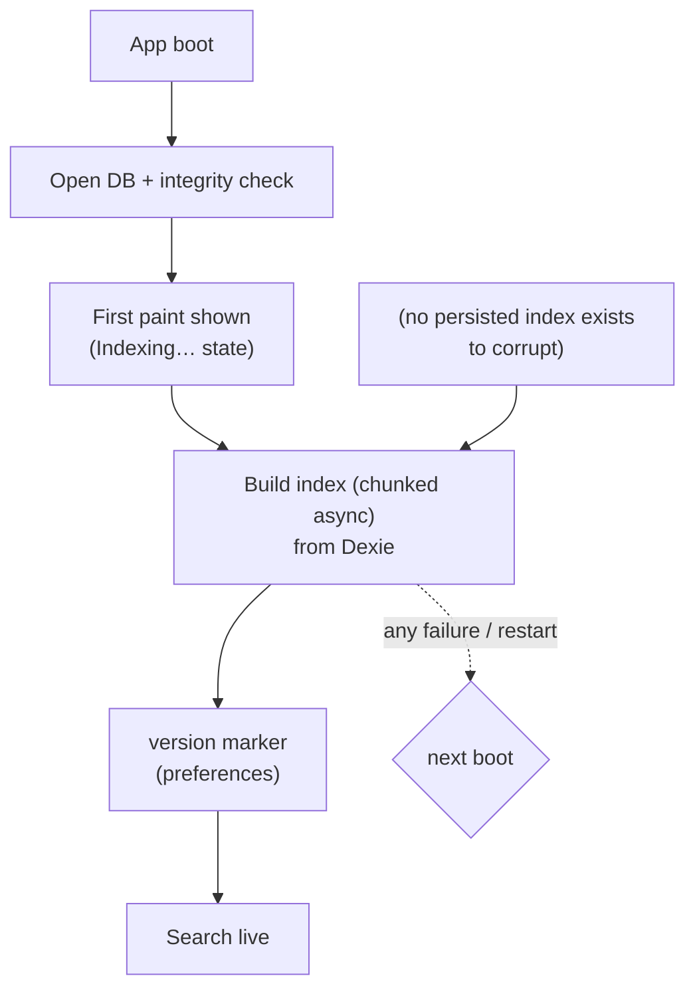

# Search & Indexing Architecture — Fluid Deck

*Phase 2.4 | Status: Draft for approval | Date: 2026-11-08*
*Sources: PRODUCT_REQUIREMENTS_DOCUMENT (FR-SRH-001–007, NFR-PER-004), INFORMATION_ARCHITECTURE, SYSTEM_ARCHITECTURE (Phase 2.1), DATABASE_SCHEMA_AND_MIGRATIONS (Phase 2.2), EXTENSION_WEB_COMMUNICATION_CONTRACTS (Phase 2.3)*

> Design-only. No code, no MiniSearch implementation, no workers. All performance figures are **proposed targets** (PRD is the acceptance range), to be benchmarked in Phase 4 — they are not measured results.

## 0. Summary

One in-memory MiniSearch index, **rebuilt from Dexie on every app start** (no persistence, no worker). Facets are computed in the Search Service over candidate IDs from indexed Dexie queries, then intersected with MiniSearch hits. Ranking = MiniSearch field weights + two explicit rules (exact-title-first); nothing ML. Dexie remains the sole source of truth; the index is disposable.

## 1. Searchable Data Model (§4)

Four layers, kept rigorously separate:

| Layer | Content | Owner | Lifetime |
|---|---|---|---|
| Canonical | `resources`, `tags`, `collections`, join rows in Dexie | Repository Layer | Permanent (until full delete) |
| Derived documents | Small objects in MiniSearch memory (one per live resource) | Search Service | Rebuilt per app start |
| Transient query state | `{q, type, collection, tags, date, source, sort}` in URL params | UI (router) | Per navigation |
| Result metadata | Hit IDs + matched terms/facets for highlighting | Search Service | Per query |

**Search document** (one per live resource, ~7 fields):

| Doc field | Source (Phase 2.2) | Indexed? | Stored? (for highlight) | Ranking weight |
|---|---|---|---|---|
| `id` | `resources.id` | no (key) | no | — |
| `title` | `resources.title` | ✅ | ✅ | **3** (highest) |
| `tagsText` | tag names joined via `resourceTags` (concatenation at build) | ✅ | ✅ | **2** |
| `description` | `resources.description` | ✅ | ✅ | **1** |
| `urlText` | `resources.canonicalUrl` + `resources.domain` tokenized | ✅ | ✅ | **0.6** |
| `collectionsText` | collection names (join via `resourceCollections`) | ✅ | no | **0.5** |
| `typeText` | `resources.type` enum value as text | ✅ | no | **0.4** |

**Not indexed:** `notes` (user-owned private text — searchable would be reasonable, but MVP scope is metadata + tags + description per FR-SRH-001; adding notes search is a one-line change the moment a user asks, not now — YAGNI), `thumbnailUrl`/`faviconUrl`/`extractionNotes`/`updatedAt` (not text), `deletedAt` (trashed resources are excluded from the index entirely), collection IDs/tag IDs (relationships, not terms).
**Not duplicated:** no denormalized full-text copies of canonical rows are stored anywhere else. `tagsText`/`collectionsText` exist only in the derived doc — recomputed at build/update time from the joins (§6). Facet/filter state is **never** stored in documents.

## 2. Tokenization & Normalization (§5)

One custom tokenizer used at *both* index time and query time (same function — the most common search bug is divergent tokenization; single-sourcing it is the whole design).

| Concern | MVP choice | Rationale |
|---|---|---|
| Case | Lowercased | — |
| Unicode | NFC-normalized | Prevents composed/decomposed diacritic mismatches at byte level |
| Diacritics | *Kept* (not folded), with normalization form above | Developers search `café` and expect exactness; folding is an enhancement with no measured user demand |
| Punctuation / non-alphanumerics | Delimiters (split) | `foo-bar` → `foo, bar`; `foo.bar` → `foo, bar` |
| Hyphenated words | Split on hyphen | Same delimiter rule — no special case |
| CamelCase / identifiers | **Split** (`useState` → `use, state`, `myVar` → `my, var`) + keep joined token | Dev persona searches identifiers; splitting makes `state` find `useState`, joined makes exact `useState` still match |
| URL tokenization | Split on `/ ? = & . - _` plus case-fold; domain tokenized separately into `domain` field | `github.com/foo/react-hooks` → `github, com, foo, react, hooks` |
| Stop words | **None removed** | A hand-rolled stop list is 50 entries of speculative linguistics; MiniSearch handles common words fine at 10k scale |
| Stemming | **None** | `running` doesn't match `run` in MVP. Acceptable, documented limitation (§7) |
| Prefix search | ✅ MiniSearch `prefix: true` on query terms | Powers ⌘K typeahead |
| Fuzzy search | ✅ MiniSearch `fuzzy: 0.2` on query terms | Typo tolerance without extra machinery |

**MiniSearch limitations (documented, accepted):** no stemming, no synonyms, no phrase/proximity search, no field-range queries — all irrelevant at MVP scale. If any becomes a measured user complaint, FTS5 migration (Phase 8+) is the seam (§7).

## 3. Ranking & Relevance (§6)

### 3.1 Weights
`title×3, tags×2, description×1, url×0.6, collections×0.5, type×0.4` (see §1). These are *field boosts* on MiniSearch's BM25-like scoring — relative ordering matters, absolute values don't.

### 3.2 Explicit rules (the only custom ranking logic)
1. **Exact title match first:** a resource whose title *exactly equals* the query (case-insensitive, whole string) is pinned above all scoring results. Rationale: "I saved this exact page" is a high-certainty intent; zero ML needed.
2. **Multi-term semantics: AND by default** (all query terms must match somewhere in the doc), with automatic degrade to OR when AND yields 0 results — and the "(showing partial matches)" UI note. AND-then-OR handles both "React hooks" (two-term precision) and typo/partial queries (recall) without a settings page.
3. **Tie-breaks:** `updatedAt` desc (recently touched first), then `title` A–Z, then `id`. Deterministic, testable.
4. **Empty query:** not a search — returns the *faceted browse* result set sorted per FR-SRH-005 (default Newest). Same code path, empty `q`.

### 3.3 What is custom vs. native
- **Native (MiniSearch):** BM25-style scoring, prefix + fuzzy matching, field boosting.
- **Custom (this design):** exact-title pin, AND-then-OR degradation, tie-breaking, facet intersection, sort override. That's the whole custom layer — a single `rank/hit-adapter` function, no score re-implementation, no ML.

### 3.4 Example queries (expected ranking stated, not measured)
- `react` → title-contains-react first (weight 3), then tags containing react, then description mentions, then URL/domain matches.
- `react hooks` (AND) → docs matching *both* terms (title/tags weighted) outrank single-term; if none, partial-OR list shown with indicator.
- `github.com/foo` → URL tokenizer matches domain + path tokens; title matches dominate if present.
- Tag name query (`design`) matches `tagsText` at weight 2 — surfaces in top-5 ahead of description noise.

## 4. Filtering & Faceted Search (§7)

**Where each operation happens (the efficiency decision):**

| Operation | Where | Why |
|---|---|---|
| Keyword query (`q`) | MiniSearch | Its job |
| Type, Source, Date range, Domain | **Dexie indexed query** (`type`, `source`, `[deletedAt+createdAt]` indexes) | Plain indexed point/range lookups — cheaper and more predictable than MiniSearch `filter` closures |
| Collection (incl. descendants) | **Dexie**: resolve collection subtree IDs → `resourceCollections` index sweep | Descendant expansion is a join, not a text problem |
| Unorganized | **Dexie**: left-anti-join (resources with zero `resourceCollections` rows) | Derived view (Phase 2.2), no index support needed |
| Tags (OR) | **Dexie**: `resourceTags` by `tagId` set | Tag semantics are set membership, not text match |
| **Facet intersection** | Search Service | Candidate IDs from MiniSearch ∩ IDs from Dexie facet queries |
| Sorting | Search Service (`updatedAt`/`createdAt`/`title` over the *result set*, or relevance order) | Result sets are small (≤ library); sorting in memory is free at 10k |
| Facet counts | Search Service: count facet values over the *post-query* candidate set | IA §3 chips need counts; computing over candidates (not the whole library) keeps them relevant |

**Order of operations:** facet sets are computed first (Dexie, precise), keyword hits are computed in parallel (MiniSearch), intersection happens in the Search Service. Empty query skips MiniSearch entirely. **Result limit:** default 500 hits (grid virtual-scrolls; >500 is a UX problem, not an engine problem — and prevents 10k-row DOM work). **AND vs OR for tags:** OR per FR-SRH-002 (any selected tag matches); AND-tag is a post-MVP filter-mode flag, not architecture.

## 5. Index Lifecycle & Synchronization (§8)

**Rule: index writes only ever follow Dexie commits.** Extension capture drafts are never indexed (Phase 2.3 already guarantees ack-after-commit; the index subscription hangs off the *same* post-commit hook, so indexing uncommitted data is structurally impossible).

| Event | Dexie writes | Index action |
|---|---|---|
| Resource create (capture/import/UI) | 1 tx (resource + joins + usageCount) | On commit: `add` 1 doc |
| Resource update | 1 tx | Diff searchable fields (`title/desc/tags/collections/type`): if changed → `replace` doc; else skip entirely (timestamp-only updates never touch the index) |
| Soft delete / restore | 1 tx (`deletedAt` flip) | `remove` doc / `add` doc back |
| Hard purge | 1 tx | `remove` doc (no-op if absent) |
| Tag/collection rename | 1 tx (tag row / collection row) | Update `tagsText`/`collectionsText` on every affected doc (targeted `replace` per affected resource; no rebuild) |
| Tag merge | 1 tx | Same as rename for affected resources |
| Bulk import | 500-row Dexie tx batches | Index `add` per batch as each batch commits (progressive results, no giant freeze) |
| Filter/sort-only changes | none | none — query-time only |

**Consistency guarantee:** the Search Service subscribes to TanStack Query invalidations that fire *after* Dexie commits on the same mutations the UI observes. If an index operation fails (disk full mid-update, etc.), the Search Service logs it and the startup rebuild (§6) is the backstop — the index heals on next launch by construction.

## 6. Rebuild & Recovery (§9)

**Decision: rebuilt on every app startup; not persisted; no workers.** At 10k resources the build is a single indexed scan + in-memory construction — estimated well under the 500ms first-paint budget; run *after* first paint (chunked async build, skeleton/grid shows cached query results only from the *previous* session? No — **cold start shows empty results with a brief "Indexing…" state** rather than lying with a stale index. Simpler and honest.) Estimated build cost is stated as a *target* to benchmark in Phase 4, not a claim.

- **Persistence? Rejected.** MiniSearch's serialization (JSON of terms) is ~2–5× the raw text size; persisting it to IndexedDB buys nothing when rebuild is cheap, and adds a cache-invalidation problem on top of a solved one. The in-memory index is *itself* the cache — rebuilt and discarded freely.
- **Versioning? One integer, one use:** store a `searchSchemaVersion` marker in `preferences`; on version bump, rebuild (same as every startup — the marker is only meaningful if the app is kept running across a migration, which is a Phase 4+ concern; included so the seam exists).
- **Startup:** open DB → integrity check (Phase 2.2 §3.3) → build index (async, chunked) → announce `indexReady` (UI gates on it; ⌘K/search show "Indexing…" until then).
- **Interrupted indexing/catastrophic index state:** impossible to persist — there is nothing on disk to corrupt. Any in-memory inconsistency is fixed by rebuild-on-next-start.
- **Stale/missing/orphan docs:** cannot distinguish from correct state without a comparison pass; not worth it — rebuild is the recovery, always.
- **DB migration impact:** migrations that change searchable fields bump `searchSchemaVersion`; rebuild absorbs them automatically.

## 7. Performance & Scalability Targets (§10)

**All numbers below are proposed targets for Phase 4 benchmarking, not measured results.**

| Scale | Build target | Query p95 target | Notes |
|---|---|---|---|
| 100 | <50 ms | <5 ms | Trivial |
| 1,000 | <150 ms | <15 ms | |
| 5,000 | <300 ms | <30 ms | |
| 10,000 (PRD max) | <500 ms | **<50 ms** (NFR-PER-004) | PRD acceptance |
| 50,000 (post-MVP) | — (out of scope) | — | Memory ceiling documented; FTS5 migration seam |

- **Incremental update:** 1 doc add/replace/remove — negligible (<1 ms target); batch combines happen only for import (500/batch).
- **Debounce UI input 150 ms** (IA §7), show skeleton if query >100 ms; **query cancellation**: trivially safe — each query runs in one synchronous pass over the in-memory index; latest-wins flag discards stale results (no worker queue to cancel).
- **Web Workers: rejected for MVP.** MiniSearch search is synchronous and fast; workers add postMessage serialization of results and a second code path (WXT background vs worker). Add only if measured build time at 10k exceeds the 500 ms target.
- **Memory:** index ≈ a few × raw text size; at 10k resources with ~200 chars/doc ≈ low tens of MB — acceptable; at 50k+ this becomes the documented FTS5 migration trigger (PRD §19.1).

## 8. Search Service & Package Boundaries (§11)

**Ownership:** `apps/web` owns the Search Service (orchestration: build → query → facet-intersect → rank → result transform). `apps/web` also owns the MiniSearch adapter/integration — a thin wrapper (≤ ~80 lines) that serializes resources into documents and executes queries; it exists *only* to keep MiniSearch's concrete API from leaking into services. **No separate adapter package.** `packages/core` owns *pure* logic: the tokenizer, URL tokenization rules, field-weight constants, ranking constants — all unit-testable without a browser or MiniSearch. `packages/extension-core`: untouched by search (extension never indexes). `packages/ui`: search *presentation* only (input, chips, facet dropdowns, highlight) — zero indexing code.

**Responsibility split:** Search Service (build/query/intersect/rank) vs Repository Layer (all Dexie reads) vs UI state (URL params) vs core-tokenizer. The Search Service reads Dexie via Repository queries; it never opens Dexie directly (Phase 2.1 single-writer rule).

## 9. Decisions, Risks, Traceability (§13)

**Decisions:** rebuild-on-every-start (no persistence); single shared tokenizer; AND-then-OR; facets-in-Dexie + intersection-in-service; chunked async build after first paint; no workers; exact-title pin as the only custom rank rule.
**Alternatives rejected:** persisted MiniSearch index (solves a cheap problem expensively); Web Worker indexing (no measured need); FTS5/SQLite now (premature — Phase 8+ seam); semantic/hybrid search (explicitly excluded from MVP); stemming/synonyms (complexity without demand); notes search (defer until asked).
**Risks:** build blocking first paint → chunked post-paint build + honest "Indexing…" state; memory at 50k → documented FTS5 trigger; fuzzy+prefix interaction surprises → small test corpus in Phase 4, tokenizer single-sourced.
**Phase 2.2 U1–U6 carried forward unchanged** (none is search-blocking; U2 collection-depth warning affects only how deep the descendant-expansion facet query walks — bounded by the ≤3-level recommendation).
**Traceability:** FR-SRH-001 (MiniSearch + <50ms p95 → §§1–3, 7) · FR-SRH-002 (facets OR/tags → §4) · FR-SRH-003 (URL state → §1 layer 3) · FR-SRH-004/007 (chips/empty states → §4, output shaping) · FR-SRH-005 (sorts → §4) · FR-SRH-006 (highlighting → §1 stored fields) · NFR-PER-004 (latency target → §7, labeled unmeasured) · Phase 2.1 §§3/6/8 (Search Service ownership, derived index) ✓ · Phase 2.2 §5 (MiniSearch derivation) ✓ · Phase 2.3 §5.4 (index-after-commit) ✓.

## 10. Required Diagrams

### 10.1 Canonical database → Search Service → MiniSearch data flow


### 10.2 Create/update/delete & index synchronization


### 10.3 Query + filtering lifecycle


### 10.4 Index rebuild & recovery


### 10.5 Package dependency direction
```mermaid
flowchart TB
    CORE["packages/core<br/>tokenizer · weights<br/>ranking constants<br/>(pure TS)"]
    WEB["apps/web<br/>Search Service<br/>MiniSearch adapter<br/>Repository Layer"]
    UI["packages/ui<br/>search input · chips<br/>facets · highlights"]
    EXC["packages/extension-core<br/>(no search surface)"]
    CORE --> WEB
    WEB --> UI
    CORE -.->|"no browser globals<br/>no MiniSearch"| NUL["(testable in Vitest)"]
    UI --> CORE
