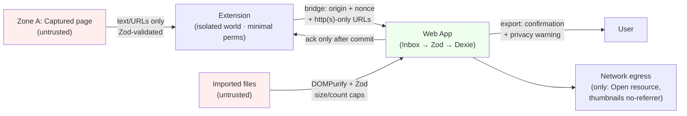
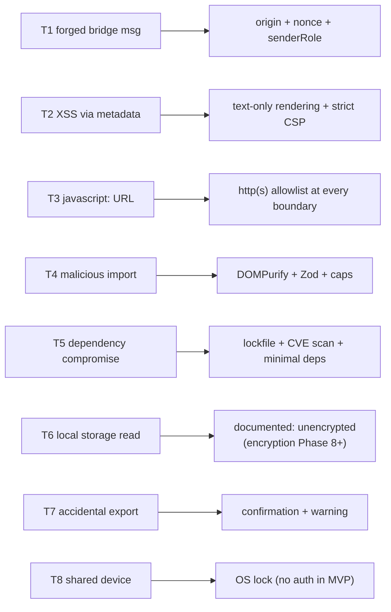
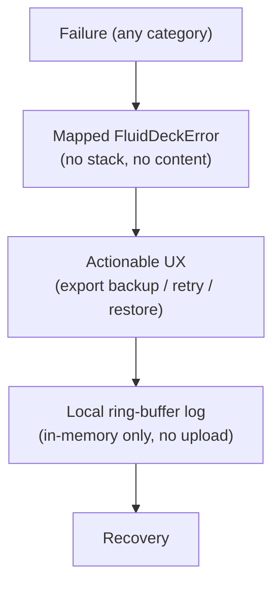

# Security & Privacy Architecture — Fluid Deck

*Phase 2.7 | Status: Draft for approval | Date: 2026-11-08*
*Sources: PRODUCT_REQUIREMENTS_DOCUMENT (FR-PRI-001–003, NFR-SEC-001–005), SYSTEM_ARCHITECTURE (Phase 2.1), DATABASE_SCHEMA_AND_MIGRATIONS (Phase 2.2), EXTENSION_WEB_COMMUNICATION_CONTRACTS (Phase 2.3), SEARCH_AND_INDEXING_ARCHITECTURE (Phase 2.4), FRONTEND_ARCHITECTURE_AND_STATE_OWNERSHIP (Phase 2.5), OFFLINE_RELIABILITY_AND_ERROR_HANDLING (Phase 2.6)*

> Design-only. Named settings, CSP directives, and mechanisms below are specifications for implementation, not code. **All numeric limits are proposed targets, labeled as such.**

## 0. Summary

Local-first is a privacy *posture*, not a security *guarantee*: IndexedDB is unencrypted, the bridge is origin-checked but not cryptographically authenticated, and `<all_urls>` is the largest trust surface. Design accordingly: least-privilege permissions, strict validation at every boundary, untrusted-content-as-text rendering, and encryption deferred (Phase 8+, NFR-SEC-005) with documented residual risk.

## 1. Threat Model (§4)

**Assets:** saved library data (titles/URLs/notes/tags reveal sensitive interests), extension pending captures, exported JSON backups, URL/filter state.
**Actors:** malicious websites (Zone A), malicious/compromised third-party extensions (Zone B), compromised dependencies, local malware, another user on a shared device, browser profile compromise.
**STRIDE-aligned skim:**

| # | Threat | Category | Mitigation (where) |
|---|---|---|---|
| T1 | Malicious page posts forged capture/ack into bridge | Spoofing | Origin+nonce+`senderRole` checks (§4) |
| T2 | XSS via saved title/description/notes | Tampering/InfoDisclosure | React text-escaping only; no `dangerouslySetInnerHTML` for third-party content; strict CSP (§4) |
| T3 | `javascript:` URL → script execution on click | Tampering | URL scheme allowlist: http/https only; rejected at Inbox + import (§5) |
| T4 | Malicious import file (HTML/JSON) → XSS, prototype pollution | Tampering | DOMPurify + Zod, size/count caps, never render imported HTML (§6) |
| T5 | Dependency compromise → exfiltration / malicious code | Tampering | pnpm lockfile, minimal deps, no analytics packages, offline verification (§7) |
| T6 | Browser storage inspection by local software | InfoDisclosure | Unencrypted data (documented limitation) + export warnings; encryption deferred (§5) |
| T7 | Accidental export/share of library | InfoDisclosure | Export confirmation + plain-language warning; private-by-default |
| T8 | Shared-device access | InfoDisclosure | No account system in MVP (FR-PRI-003) — OS-level device lock is the control; residual risk noted (§5) |

**Out of scope (explicit):** protection against a compromised OS/browser profile or a malicious extension with `<all_urls>` permissions of its own (such an extension can already read anything on the web; Fluid Deck's data is no more exposed than the user's browsing history to it). These are documented, not solved.

## 2. Extension Security (§5)

**Permissions (minimum set):** `storage` (outbox), `activeTab` + `scripting` (content-script injection on the active tab, user-invoked), `contextMenus` ("Save to Fluid Deck"), `<all_urls>` (content script injection on arbitrary pages, FR-CAP-001/B1 requires store install). No `tabs` read beyond active tab, no history/cookies/webRequest. `<all_urls>` is the trust trade-off: broad in scope, justified because capture must work on any page; it appears in the store listing at install time (Phase 2.1 §10). **No optional permissions** — everything above is required for core flows.
**Content scripts:** run in the **isolated world** (no page-JS access, no page-JS access to them); extraction reads DOM and returns text/URLs only; never executes page-provided scripts; hostile DOM content treated as untrusted text; timeouts on extraction. Main-world only via `scripting.executeScript` when needed (SPA cases), with a hard timeout.
**Background/service worker:** Queue Coordinator is the sole owner of `chrome.storage.local` outbox; all messages validated (Phase 2.3); untrusted inputs (page data, ack messages) never reach storage without Zod validation.
**Storage:** `chrome.storage.local` is **not encrypted** (browser-profile-level access only); pending captures retain until ack; cleanup only via ack; corrupted entries marked permanently failed on first validation error, deleted only after user-visible acknowledgment (§3).

## 3. Cross-Origin Bridge Security (§6, per Phase 2.3)

| Guarantee class | Mechanism |
|---|---|
| **Browser-enforced** | `externally_connectable` exact-origin allowlist; `MessageSender.id` (extension identity) verified by the browser on `tabs.sendMessage`/`runtime.sendMessage`; isolated world |
| **Application-level** | `window.postMessage` `targetOrigin` + origin check on receipt; per-load nonce (`sessionStorage`, never persisted); envelope `senderRole`; Zod validation; protocol-version rejection |
| **Best-effort** | Nonce binding across tabs; 64 KiB message cap; http(s)-only URL hygiene; no-replay-by-design (canonicalUrl idempotency) |
| **Not provided** | Cryptographic authentication of the web app (no shared secret, no PKI); protection against XSS in the web app itself; protection against a malicious extension with broad host permissions |

**Origin checks and nonce checks are integrity/origin checks, NOT cryptographic authentication** — anywhere upstream text suggested otherwise, this sentence corrects it. If that limitation becomes unacceptable, the smallest compatible mitigation is a **per-install pairing secret** (extension generates, web app asks user to confirm a pairing code) — not implemented in MVP because no demonstrated threat justifies it; noted as a Phase 8+ option. Protocol downgrade is impossible: unknown `protocolVersion` is rejected with permanent `nack{version}`.

## 4. Web Application Security (§7)

- **Rendering:** all Zone A fields (title/description/notes/imported metadata) rendered **as text only**. `dangerouslySetInnerHTML` is prohibited for any third-party or imported content (lint rule); React escaping is the default defense. Rich HTML rendering of saved content is **rejected** — the PRD doesn't require it, so it doesn't exist.
- **External images:** lazy-loaded `` with `referrerPolicy="no-referrer"` (avoids leaking the library URL to thumbnail hosts), `loading="lazy"`, and sandboxed? For MVP, image loading is ``-only (no script capability in an ``), plus loading failure → placeholder.
- **Links:** external navigation via plain `<a>` with `target="_blank" rel="noreferrer noopener"` (no `window.opener` access). No `javascript:` URLs ever reach an `href` (§5 allowlist).
- **CSP (proposed target, strict):** `default-src 'self'; script-src 'self' (no `unsafe-inline`); style-src 'self'; img-src 'self' https: data: (only if thumbnail placeholder needs it — omit `data:` if possible); connect-src 'none'; frame-ancestors 'none'; base-uri 'self'; form-action 'self'`. Nonce-based styles only if a library requires it — not in MVP.
- **URLs in browser state:** query params contain filters only; no sensitive fields (notes, credentials) in URL.
- **Console:** no logging of user content; errors logged locally only (§7).

## 5. URL & Metadata Security (§8)

Allowlist: `http:` and `https:` only. Rejected at every boundary (Inbox, import): `javascript:`, `data:`, `file:`, `blob:`, `chrome:`, `about:`, `extension:`, relative URLs. IDN/punycode: display host as punycode (`xn--`) to the user when non-ASCII (homograph defense); loopback/private-IP hosts are allowed (local dev) but *displayed* with a warning chip. URL validation proves **syntax**, never trustworthiness — messaging copy never says "safe site". External images: `referrerPolicy="no-referrer"` (§4); no prefetch of thumbnail URLs (no hidden network requests).

## 6. IndexedDB & Local Data Protection (§9)

IndexedDB is **not encrypted by default**; same-origin JS can read it; a malicious local extension or malware on an unlocked device can read it. Encryption at rest is **deferred to Phase 8+ (NFR-SEC-005)** — correct call: at-rest encryption needs key management (decrypt-on-unlock password, key derivation, migration of existing stores, re-indexing implications) that would dominate MVP scope. **Documented residual risks:** shared-device access (user's OS account is the boundary), browser profile inspection, export file exposure. **Future encryption (Phase 8+) would require:** lock-screen passphrase, credential derivation (Argon2id-class), per-DB key wrapping, re-encryption migration path, and re-indexing on unlock — architecture seam reserved, not built.

## 7. Import/Export Security (§10)

**Import:** DOMPurify + Zod at the boundary (RFCs NFR-SEC-002); file-size cap (proposed: 50 MB HTML / 20 MB JSON — **proposed targets**); record cap (proposed: 100k records — generous vs. 10k MVP scale); nested-depth limit on JSON (proposed: 20 levels, prototype pollution guard); `__proto__`/constructor keys stripped; URLs re-validated (§5); never executes imported content; never renders imported HTML; transaction-wrapped commit (Phase 2.6 §5). **Export:** generated safely (no script execution when opened, NFR-SEC-003), safe download filename (`fluid-deck-export-YYYY-MM-DD.json`), user confirmation + plain-language warning ("This file contains your library — keep it private"). Exported data exposure is a user action, not a system leak.

## 8. Privacy (§11/§12-equiv)

- **Zero telemetry (FR-PRI-001):** no analytics, no crash reporting, no usage tracking, no network requests on a clean install (verifiable — Phase 4 check). Network calls exist in exactly three places: user-initiated "Open resource" navigation, user-initiated thumbnail loads (`no-referrer`), and store update checks (browser-controlled, outside app code).
- **User control:** one-click full delete (FR-PRI-002, type-to-confirm, export-first prompt); data portability via JSON export.
- **No accounts (FR-PRI-003):** no auth server, no credentials stored, no session tokens anywhere in the stack.
- **Sensitive data handling:** notes treated as private (never indexed, never exported except JSON/MD by design, excluded from search index).
- **Fingerprinting surface:** none — no cookies, no localStorage analytics, no cross-origin fetches beyond §8 allowlist.

## 9. Dependency & Supply-Chain Security (§13-equiv)

pnpm lockfile in version control; every dependency scanned at CI time (Phase 4 implementation) for known CVEs; WXT + Vite toolchain pinned; DevDependencies isolated from runtime bundle; bundle analyzed for unexpected network imports before release; minimal dependency surface (ponytail — every dep must earn its place; specifically rejected: analytics SDKs, telemetry, remote font CDNs).

## 10. Required Diagrams

### 10.1 Trust boundaries & data flow


### 10.2 Threat & mitigation map


### 10.3 Failure/recovery lifecycle (privacy-preserving)


## 11. Decisions, Risks & Traceability (§15-equiv)

**Decided:** 4-permission minimum set; isolated-world content scripts; text-only rendering; http(s) allowlist; deferred encryption (Phase 8+); export confirmation; zero telemetry; no shared-secret pair.
**Alternatives rejected:** shared-secret bridge auth (no demonstrated threat; documented upgrade path); at-rest encryption now (key-management scope explosion, NFR-SEC-005 agrees); rich HTML rendering (no requirement); runtime CSP relaxation; telemetry (FR-PRI-001).
**Risks:** `<all_urls>` scope (store-listing transparency is the mitigation); unencrypted local data (documented, Phase 8+ seam); shared device (OS lock); dependency compromise (lockfile + scan + minimal deps).
**Phase 2.2 U1–U6 carried forward unchanged; Phase 2.3 retry values remain proposals.**
**Traceability:** FR-PRI-001–003 → §8 · NFR-SEC-001–005 → §§2, 7, 5, 4, 6 resp. · Phase 2.1 §10 (Zone A/B) · Phase 2.2 §3.4 (guarded full delete) · Phase 2.3 §§4–5 (bridge trust) · Phase 2.4 §1 (notes excluded from index) · Phase 2.5 §4 (no global-state data duplication) · Phase 2.6 §§6–7 (quota/zero telemetry) ✓

```text
Verification: all brief §18 items checked. No tests/benchmarks run (documentation only).
```
