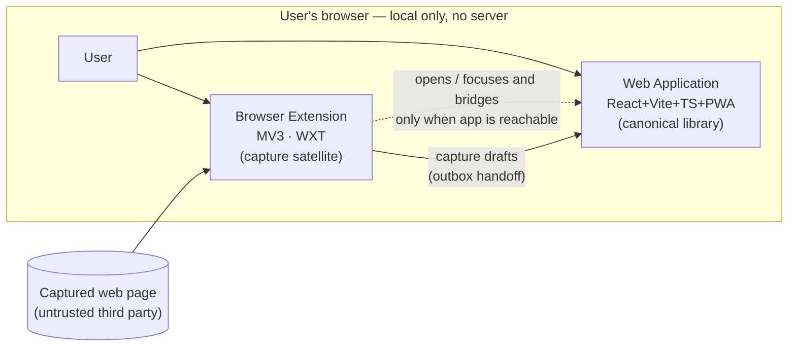
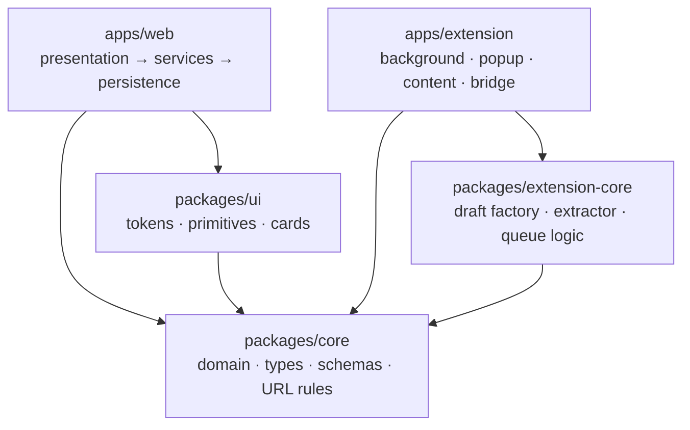
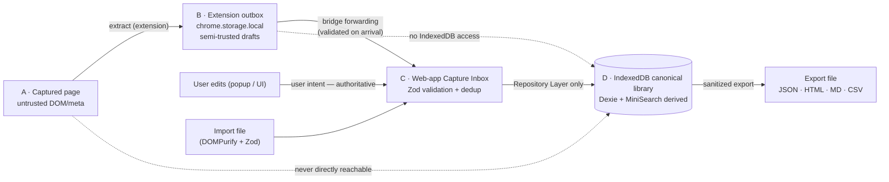
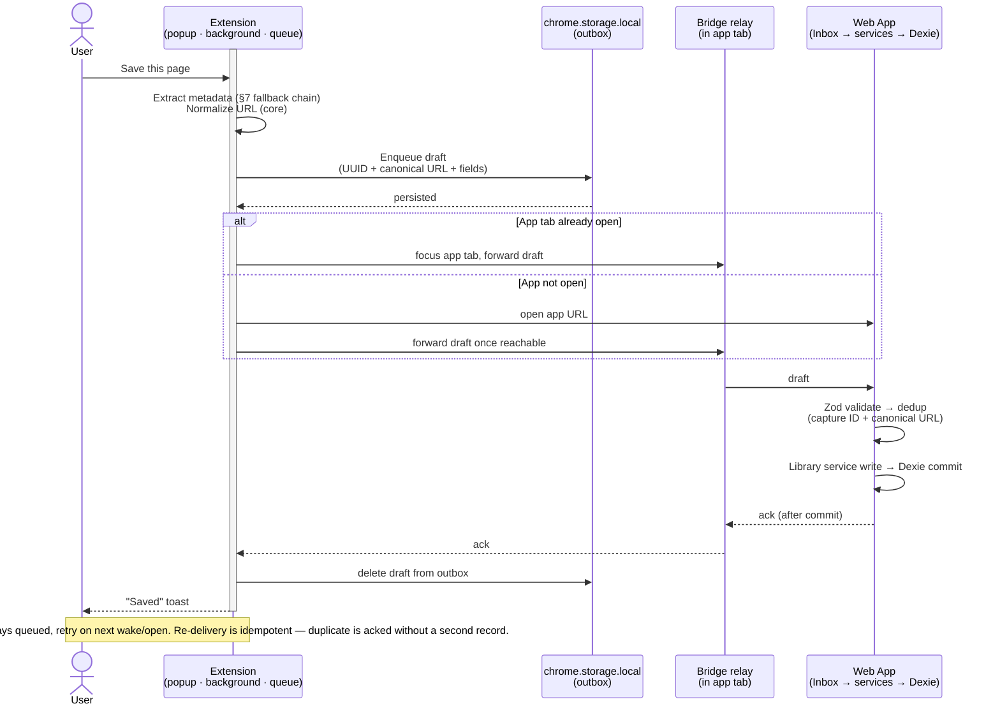

# System Architecture & Boundaries — Fluid Deck

*Phase 2.1 | Status: Draft for approval | Date: 2026-11-08*
*Sources: PRODUCT_REQUIREMENTS_DOCUMENT, PHASE_1_FINAL_REVIEW, TECHNICAL_DIRECTION_EVALUATION, INFORMATION_ARCHITECTURE, USER_JOURNEYS_AND_WORKFLOWS, MVP_FEATURE_PRIORITIZATION, PROJECT_PROGRESS, ENVIRONMENT_AUDIT, PRD_CONSISTENCY_AUDIT*

> Architecture and documentation only. No code, schemas, messaging contracts, or infrastructure. Detailed messaging contracts belong to Phase 2.3; database schema/design to Phase 2.2.

## 0. Architecture Style — Decision

**Lightweight layered architecture** with explicit module boundaries inside each app. Full ports-and-adapters rejected for MVP.

**Reasoning (first principles):** Single-user, local-first, no backend, no sync, no auth in MVP. There is one storage engine (IndexedDB via Dexie), one search engine (MiniSearch in-memory), and one capture path (extension → web app). There is no external system to adapt to, no second production adapter to swap in. Ports-and-adapters would create an interface for every Dexie call, MiniSearch call, and `chrome.*` call — interfaces with exactly one implementation — which is the over-engineering Phase 1 explicitly forbids. The lazy rule: only create an abstraction where two real adapters exist or where a test needs to fake the boundary.

**What layered gives us (and why it suffices):**
- Three layers in the web app: `presentation` (React + TanStack Query + Context) → `domain services` (organization, search, import/export use-cases) → `persistence` (Dexie repositories + MiniSearch index builder). Dependencies point downward only; presentation never touches Dexie directly.
- Two layers in the extension: `UI (popup/side-panel)` → `background/queue coordinator (storage + bridge)`. No third layer needed.
- Real, demonstrated needs get a boundary — and only those: storage vs. UI (test domain logic without a browser DB), queue coordinator vs. popup (test retry/idempotency without launching the extension), and the extension↔web-app bridge (the one true cross-origin boundary in the system). Everywhere else, call the function directly.

**Trade-off accepted:** When SQLite WASM + FTS5 arrive in Phase 8+, the persistence layer is replaced wholesale (one layer, one migration point). With ports-and-adapters this would be prettier, but building for a certain future adapter today — before IndexedDB sufficiency is even validated — violates the "no premature SQLite migration" constraint. The layered cut at the repository is the migration seam.

## 1. System Context

Fluid Deck is a single-user, local-first personal library. There is no server in MVP. The "system" is two client surfaces, run on the user's own machine, plus the browser's local storage primitives.

- **Web application (PWA):** the canonical library — owns all resources, collections, tags, search index, import/export.
- **Browser extension (Manifest V3, WXT):** a capture satellite. It produces *capture drafts* (URL + extracted metadata) and holds them in a temporary outbox. It never owns canonical records.
- **Browser primitives:** IndexedDB (web app data), `chrome.storage.local` (extension outbox + extension-local prefs), Service Worker / Event Page (extension runtime, ephemeral), DOM of the captured page (metadata source).

Actors: the User (saves, searches, organizes, imports/exports); the Captured Web Page (untrusted third-party site providing metadata); the Browser (security authority enforcing origin separation between extension and web app).

Out of system in MVP: any network service, account/auth, sync, telemetry, vector/semantic search, microservices, CLI/API capture, native mobile/desktop.



## 2. Major Components and Responsibilities

### Web application (`apps/web`)

| Component | Responsibility |
|---|---|
| Library UI (sidebar, top bar, grid, ⌘K) | Rendering, filters-as-URL-state, card variants. No direct storage access. |
| Capture Inbox | Receives drafts from the bridge, validates them, writes canonical records, acknowledges. Sole writer of Resources from extension traffic. |
| Library Services (domain) | Collections, tags, dedup (canonical-URL check), soft delete/trash, import/export use-cases. Pure domain rules. |
| Search Service | Owns the MiniSearch index; rebuilds from IndexedDB on load, incrementally updates on mutation. Answers keyword + faceted queries. |
| Repository Layer (Dexie) | All IndexedDB access. One repository per entity (Resource, Collection, Tag, …). |

### Browser extension (`apps/extension`)

| Component | Responsibility |
|---|---|
| Capture UI (action popup / side panel, context menu) | Trigger save, show extracted metadata, collect optional collection/tags, toast. |
| Metadata Extractor | Reads the live page (content script; offscreen document on Chromium for SPA cases) → draft fields. |
| Queue Coordinator (outbox) | Persists drafts to `chrome.storage.local`, delivers via the bridge, retries, marks acked items done. Sole owner of the outbox. |
| Bridge | The only code aware of the web-app origin. Opens/focuses the app tab and forwards drafts. |

### Shared packages (`packages/`)

See §5. `core` (domain), `ui` (presentation), `extension-core` (capture/queue helpers). No app-specific state lives in shared packages.

## 3. Web Application Boundaries

- **In:** validated capture drafts from the bridge; import files (browser HTML via DOMPurify + Zod, Raindrop JSON via Zod); user edits through the UI.
- **Out:** canonical Resource/Collection/Tag records in IndexedDB; MiniSearch query results; export files (JSON/HTML/MD/CSV); acknowledgements back through the bridge.
- **Rules:**
  - The Capture Inbox is the only entry point for extension data; UI code never reads the bridge or outbox.
  - All writes go through the Repository Layer + Library Services (dedup, normalization, timestamps, soft delete) so import, capture, and UI edits share identical rules.
  - Search is a derived, rebuildable view — never the source of truth.
  - The web app never imports from `extension-core` runtime code (only types via `core`).

```
apps/web
  src/
    presentation/   React components, routes, ⌘K, grid, sidebar (TanStack Query hooks)
    services/       Library services, Search service, Capture Inbox, Import/Export services
    persistence/    Dexie repositories, index builder, integrity check
    bridge/         Web-app side of the handoff (listener + ack sender)
```

## 4. Extension Boundaries

- **In:** the active tab's DOM (via content script / offscreen document); user choices in the popup; acknowledgements from the web app.
- **Out:** capture drafts + delivery attempts to the web app; nothing else. The extension never writes IndexedDB, never indexes, never organizes.
- **Rules:**
  - The Queue Coordinator is the only component that touches `chrome.storage.local` for the outbox and the only one that talks to the bridge.
  - Popup/context menu only enqueue a draft — they never await the web app. Save feedback is "Captured" (queued) vs. "Saved" (acknowledged) and must not be conflated (see §11).
  - Extension keeps no canonical copies: once acked, the draft is deleted from the outbox.
  - Minimal permissions only: `storage`, `activeTab`/`scripting`, `contextMenus`, `<all_urls>` (content-script injection). No `tabs` read beyond the active tab, no history/cookies.

```
apps/extension
  background/       Queue coordinator, badge/pending counter, delivery loop
  popup/            Capture UI
  content/          Isolated-world metadata extractor (+ optional bridge relay)
  offscreen/        Chromium SPA extraction fallback
  bridge/           Origin-aware open/focus + forward + ack receive
```

## 5. Shared Package Responsibilities

Approved direction: `core`, `ui`, `extension-core` under pnpm workspaces. Evaluated against the proposed split:

| Package | Owns | Explicitly does NOT own |
|---|---|---|
| `core` | Domain models + Resource/Type/Source enums; URL normalization/canonicalization; rule-based type detection; Zod schemas for drafts, import formats, and exports; shared business rules (dedup key, collection non-destructive delete, soft-delete/purge rule). | Any React, any Dexie, any `chrome.*`. Pure TypeScript. |
| `ui` | Design tokens, reusable primitives (chips, buttons, palette shell), type-aware card components, empty/loading/error states. | Any storage, search, or extension code. Props in, events out. |
| `extension-core` | Capture-draft factory, metadata-extraction interfaces + fallback chain, outbox queue coordinator logic (idempotent IDs, retry/backoff policy, drain-on-ack), extension utilities (`browser.*` promise wrapper). | Canonical records, Dexie, MiniSearch, web-app UI. |

**Dependency direction (strictly one-way, no cycles):**



- `core` depends on nothing. `ui` and `extension-core` depend only on `core`. Apps depend on packages, never the reverse; `apps/web` must not import `extension-core` runtime code at runtime (it may share types through `core`).
- The Queue Coordinator logic lives in `extension-core` (not in `apps/extension` background directly) because its retry/idempotency rules are the most test-worthy non-UI logic in the system and must be unit-testable without a browser. The background script is a thin host that imports it.
- **Cut if it doesn't earn its keep:** no shared package exists "for later" — no sync package, no ML package, no desktop package, no generic service-bus or event framework. Three packages is already the MVP ceiling.

## 6. Storage Ownership

One owner per store. No shared writes, no dual ownership.

| Store | Owner (sole writer) | Contents | Lifetime |
|---|---|---|---|
| IndexedDB (Dexie) — Resources, Collections, Tags, memberships, Saved Searches | Web application (Repository Layer) | Canonical library | Until full-data delete; soft delete + 30-day purge for Resources |
| `chrome.storage.local` — outbox | Extension Queue Coordinator | Pending capture drafts + delivery metadata (attempts, timestamps) | Until acked (then deleted); survives service-worker termination and browser restarts |
| `chrome.storage.local` — extension prefs | Extension | Last-used collection, popup prefs | Until user clears |
| Browser local preferences (web app) | Web app | UI prefs (density, sidebar), filter/sort view state | User-controlled reset |
| MiniSearch index | Web app Search Service (derived) | Index over Resources | Rebuilt from IndexedDB on load; never persisted as truth |
| Service Worker memory (both surfaces) | Nobody — ephemeral | Nothing critical | Dies freely; no state may live only here |

**Consequences:** Backup = IndexedDB contents (export). The outbox is not part of the library and is never exported. Quota errors are handled per-store: IndexedDB full → export-then-delete guidance (PRD §12); outbox full → stop accepting captures with a clear error rather than silently dropping.

## 7. Metadata Extraction

**Where:** entirely in the extension, at capture time, from the live page. The web app receives extracted fields as part of the draft; it does not fetch page metadata (it often has no right to, and must never re-scrape third-party pages).

**Fallback chain (first hit wins, each step in `extension-core`):**
1. Open Graph (`og:title`, `og:description`, `og:image`, `og:url`)
2. Twitter Card metas
3. `<title>`, meta description, canonical link, favicon
4. First meaningful `` in the article/main region
5. URL-derived title (domain + path slug) and `type: other`

**Type detection (rule-based, in `core`, 8 types):** URL host/path patterns (`github.com` → github repo, `npmjs.com` → npm, `.pdf` → pdf, youtube/vimeo → video, figma/dribbble/behance → design, …) then OG `type` and path heuristics; default `other`. Target >95% accuracy on the test corpus; the popup lets the user override — user intent always wins.

**Extraction boundaries:**
- Content scripts run in an isolated world; main-world access only via `scripting.executeScript` when needed, with timeouts.
- Offscreen Document (Chromium) only for SPA/JS-rendered pages that content scripts cannot read synchronously; Firefox uses content-script-only and accepts the variance (documented limitation).
- **Extraction failure is not capture failure.** A draft with only URL + derived title is still a successful capture (zero mandatory fields). Failures are recorded on the draft (which chain step failed) for user-visible fallback, never silently dropped.
- Thumbnails: store the image URL only in MVP. No downloading, no Blob persistence (quota risk per PRD §19.1). Lazy-load with placeholder in the grid.
- URL normalization (strip UTM, `www`, fragments, sort query params, punycode decode) runs in `core` at both enqueue (extension) and acceptance (web app) so dedup keys match on both sides.

## 8. Search and Indexing

- **Engine:** MiniSearch, in-memory, in the web app only.
- **Indexed fields:** title, URL, description, tags, extracted text fields. Field weighting (title > tags > description > URL) and the faceted-filter combination live in the Search Service.
- **Lifecycle:** built from IndexedDB on app load; incrementally updated on every Library-service mutation through TanStack Query invalidation. The index is disposable — deleting it must produce identical results after rebuild.
- **Faceted filters** (Type, Collection incl. descendants, Tags OR, Date range, Source, Has Code, Has Image) are computed at query time over the MiniSearch result set; filter state lives in the URL (IA §3) so results are shareable and restorable.
- **Performance budget (PRD):** <50 ms p95 at 10k resources; index build non-blocking on load.
- **Migration seam:** the Search Service interface is the replacement point for SQLite FTS5 in Phase 8+. No semantic/vector search in MVP — no embeddings, no vector store, no background model downloads.

## 9. Import/Export

Both surfaces run in the web app (Library Services layer). The extension is not involved.

- **Import — Browser HTML (Netscape format):** parsed in the web app; folder hierarchy → Collection tree, bookmark metadata → Resources. **Import — Raindrop JSON:** full fidelity (nested collections, tags, metadata). Both go through Zod validation and DOMPurify sanitization before any write.
- **Import flow (all sources):** parse → preview (counts + conflict list) → user resolution (per-conflict and bulk: Skip / Update Metadata / Add to Collections) → transactional write through the same Library Services as capture (so dedup/normalization rules are identical). Partial import on corrupt file rolls back; nothing writes before preview approval.
- **Export — JSON (full fidelity, lossless round-trip), HTML (Netscape-compatible), Markdown (frontmatter), CSV (flat).** Scope: All / Current Filter / Selected / Collection. Output sanitized so exported HTML cannot execute scripts when opened. Streaming generation for large libraries (target <30 s at 10k).
- **Portability guarantee:** JSON import → export → import preserves all core fields. Export is a first-class feature (IA principle 7), not an afterthought, and must not require the extension or any network path.

## 10. Data Ownership and Trust Boundaries

Four trust zones. Data crosses a zone only through the named mechanism, validated at the crossing.

| Zone | Contents | Trust posture |
|---|---|---|
| **A. Captured page** | Third-party DOM + meta tags | Untrusted. All fields are hints. Never rendered as HTML, never executed. |
| **B. Extension (outbox)** | Capture drafts in `chrome.storage.local` | Semi-trusted. Produced from A + user edit; still unvalidated at rest; must be validated by Zone C. |
| **C. Web app inbox** | Draft validation boundary (Zod) | Trust is *granted here only*: schema → canonicalize URL → dedup check → service write. |
| **D. Canonical library** | IndexedDB records | Trusted. Only the Repository Layer has write access; UI and import/export go through Library Services. |



- **Ownership summary:** the web app owns canonical records; the extension owns only the outbox; the user owns the data (exportable at any time, full delete with verification). No zone other than A/B holds third-party-derived data, and Zone D is reachable only through validation in C or sanitized import.
- **Sanitization rules:** Zone A fields interpolated into the UI only as text (React escaping + explicit `no dangerouslySetInnerHTML` for third-party content); imported HTML via DOMPurify; exported HTML generated safely (no script execution on open); strict CSP, no inline scripts.

## 11. Offline and Failure Behavior

**Offline is the default state.** Every core operation (save, search, organize, import, export) is fully local. The extension capture path requires no network at any point: extraction reads the already-loaded page, the outbox is local, and delivery to the web app is a local browser mechanism. PWA Service Worker covers offline web app.

| Failure | Behavior | Recovery |
|---|---|---|
| Web app closed when extension saves | Draft persists in outbox; user told "Captured — will sync when Fluid Deck is open" | Delivered on next app open; pending badge/count visible |
| Service Worker terminated mid-delivery | Outbox + untried state survive (never held in memory) | Delivery loop resumes on next background wake; duplicates deduplicated by ID |
| Web app reachable but write fails (quota, DB error) | No acknowledgement sent | Draft stays queued; retry with backoff; user sees failure with export guidance |
| Duplicate delivery (retry after ambiguous ack) | Web app deduplicates by capture ID + canonical URL | Second delivery is a no-op success; ack re-sent |
| Duplicate URL already in library | Dedup check in Inbox → user choice (Update / Add to Collections / Skip) | Atomic per user choice |
| Metadata extraction fails | Capture still succeeds with fallback fields | Failures noted on the draft; user can edit |
| Import parse/validation fails | Preview never opens; nothing written | Partial import rolled back; clear error |
| IndexedDB quota exceeded | Writes blocked with explicit error | Export backup → delete → resume |
| Startup integrity check fails | Corruption reported before use | Restore-from-backup offered; corrupt records quarantined |
| Outbox storage full | Capture refused with explicit error | User prompted to open the app to drain, or delete drafts |

## 12. Security and Privacy

**Privacy (MVP, per PRD §15):**
- Zero telemetry by default — no analytics, crash reporting, or usage tracking. No network calls exist to report to. Any future opt-in analytics is out of MVP scope.
- No account, no authentication, no server. "Sign in" screens do not exist.
- Full data delete: one-click IndexedDB + outbox purge with confirmation and verification.
- Extension permissions minimized to the declared set (§4); `<all_urls>` is justified solely by content-script injection and appears in the store listing at install time.

**Security:**
- Zones A/B are untrusted until validated in the Inbox (Zod) — every draft field, every import row.
- Import sanitization (DOMPurify + Zod), export safety, strict CSP (round: no `unsafe-inline`), React text-escaping as default.
- Manifest V3, isolated-world content scripts; no `eval`, no remote code.
- No encryption at rest in MVP (Phase 8+ per PRD); browser profile/IndexedDB protection is the stated, user-visible posture — not obscured.
- The bridge message origin check (web-app side) and extension-ID check must both be enforced; any page can post `window.postMessage` — only the bridge relay may forward into the Inbox. (Protocol detail: Phase 2.3.)

## 13. Cross-Browser Considerations

| Concern | Chrome / Edge (Chromium) | Firefox | Impact on design |
|---|---|---|---|
| Background runtime | Service Worker (ephemeral) | Event Page (ephemeral) | All state in `storage.local`; never module-scope. WXT + `webextension-polyfill` abstracts the API surface. |
| DOM extraction for SPAs | Offscreen Document available | Content script only | Extension accepts lower SPA extraction fidelity on Firefox; fallback chain (§7) absorbs it. |
| Storage API | `chrome.storage.local` | `browser.storage.local` | Polyfill normalizes; outbox format identical. |
| Build targets | Per-browser manifests from one source (WXT) | Same | One queue/bridge implementation, three manifest variants. |
| Side panel / popup | Side panel + action popup | Popup primary | Same capture UI in popup; side panel is an enhancement, not a requirement. |
| Safari | Deferred to Phase 8+ (different bundle/review) | — | No Safari code paths, no `webkit.*` branches in MVP. |

Web app (PWA) is browser-agnostic: IndexedDB, Service Worker, and file downloads are supported in all three target browsers; tested in Chromium + Firefox per Phase 1.7.

## 14. Risks and Mitigations

| Risk | Likelihood / Impact | Mitigation (architecture-level) |
|---|---|---|
| MV3 worker termination loses in-flight delivery | High / Medium | Outbox-durable queue; memory holds nothing critical; drain loop is resumable; idempotent IDs make resume safe (§11). |
| Firefox event-page / content-script variance | Medium / Medium | Single WXT source + polyfill; offscreen only as Chromium enhancement; extraction fallback chain. |
| Web app closed at capture time | High / Low | Outbox retains; pending visibility; drain on next open (§11, §5 handoff). |
| Duplicate delivery after ambiguous ack | Medium / Medium | Capture ID + canonical-URL dedup; re-ack on duplicate; web app is the single dedup authority. |
| IndexedDB quota at 10k+ resources | Medium / High | URLs-only thumbnails; lazy load; quota error UX; export-first guidance. No premature SQLite. |
| MiniSearch memory/latency at scale | Low (MVP) / Medium | In-memory index with budget; incremental updates; FTS5 seam reserved for Phase 8+. |
| Malicious/malformed page or import content | Medium / High | Zone A treated as untrusted; Zod at every boundary; DOMPurify; CSP; React escaping (§10). |
| Bridge impersonation (any page posting messages) | Medium / High | Origin + extension-ID validation on both sides (protocol: Phase 2.3); Inbox accepts only bridge-relayed, schema-valid drafts. |
| URL normalization false positives/negatives | Medium / Low | Single normalization implementation in `core` used by both surfaces; user choice on conflict; test corpus. |
| Import format drift (Raindrop schema changes) | Medium / Medium | Version detection in parser; Zod failure → graceful error; preview-before-commit. |

## 15. Future Evolution

Explicitly out of MVP, with the seam that makes each cheap to add later:

| Evolution | Seam already present | Trigger |
|---|---|---|
| SQLite WASM + FTS5 (replace Dexie + MiniSearch) | Repository Layer + Search Service (one layer each) | IndexedDB measured insufficient at 10k+ or FTS5 parity needed |
| Optional encrypted sync (user-keyed, cross-device) | TanStack Query mutation pattern; canonical records are the sync payload; capture IDs + timestamps give a merge key | User demand beyond single device |
| Self-hosted sync server (Docker) | No server exists today — sync is the only reason one appears; auth model deferred entirely | Phase 8+ decision |
| Semantic / visual search (local embeddings, pHash) | Search Service composition point; extracted fields flow through `core` | "Keyword not enough" feedback |
| CLI / REST API / share-target capture | Capture Inbox is transport-agnostic: any future sender emits the same validated draft shape | Capture demand beyond the extension |
| Tauri desktop (native SQLite) | Same Repository/search seams; UI travels as-is | Native-app demand |
| Local encryption at rest | Repository Layer is the single encryption point | Threat-model priority |

No sync, auth, or server code may be scaffolded in MVP to "prepare" for these — the seams above cost nothing to keep.

## Appendix A. Extension ↔ Web-App Capture Handoff (§5 detail, no contracts)

### Recommendation — simplest reliable MVP approach

**Durable outbox + explicit open/bridge delivery + ack-gated deletion.** Three mechanisms, no more:

1. **Queue (durability).** Every draft is written to `chrome.storage.local` *before* any delivery attempt. The service worker may die at any moment; the draft survives. Each draft carries a client-generated capture ID (UUID) used for idempotency end-to-end.
2. **Delivery (explicit, user-visible).** On save, if the web app is open as a tab, the extension focuses it and forwards via its bridge relay (content script in the app origin, validated by extension ID) with the app's Inbox listening and validating (Zod) before writing through the Repository Layer. If the app is not open, the extension opens it (or offers it from the popup) and forwards once reachable. *No silent background delivery and no polling the app from a background page* — delivery only happens through the bridge into an open app tab.
3. **Acknowledgement (correctness).** The app acknowledges *only after* the Dexie write commits. The extension deletes the draft from the outbox only on ack. No ack → draft stays queued → retried (with backoff, on next wake/open). Timeout/ambiguity is safe: re-delivery is deduplicated by capture ID + canonical URL, and the app re-acks.

### Evaluation of the required concerns

- **Extension-to-open-web-app messaging:** runtime messaging from the extension to a content-script relay inside the app tab; the app listens via the relay, not raw `window.postMessage` from arbitrary pages. Alternatives rejected: native messaging (overkill, install friction), a shared `storage.local` poll by the web page (web pages cannot read extension storage — a non-starter), and a local HTTP endpoint (opens a network attack surface for a zero-network product).
- **Service-worker termination / queue persistence:** solved by construction — the outbox *is* the state; background memory is a cache of it.
- **Acknowledgement and retry:** ack-after-commit; backoff retry; drafts are never deleted optimistically.
- **Duplicate delivery / idempotency:** capture ID is the idempotency key; canonical-URL dedup in the app prevents double records even if IDs differ.
- **Web app closed:** the common case. Drafts wait; the popup shows "Captured — pending" and the badge shows a pending count; the app drains the outbox on load (via bridge) and acks per draft.
- **Pending capture visibility:** pending count on the extension badge + explicit copy in the popup ("Saved to Fluid Deck" only after ack; "Captured — will arrive when Fluid Deck is open" before). A "View pending" affordance opens the app.
- **Failure recovery:** any failed stage leaves the draft queued with a user-visible reason; storage-full refuses capture instead of dropping; nothing is lost silently. Full table: §11.



## Appendix B. Unresolved Decisions (for Phase 2.2 / 2.3+)

| # | Decision | Options | Architecture impact | Owner / phase |
|---|---|---|---|---|
| 1 | Bridge protocol (message shapes, origin handshake, relay contract) | `externally_connectable` + content relay vs. alternative | Extends §5/§10 checks; never changes storage ownership | Phase 2.3 |
| 2 | Dexie schema, indexes, versioning/migration plan | One DB vs. sharded; index set | Fills §3 persistence detail | Phase 2.2 |
| 3 | Draft field set + draft vs. canonical model delta | Lean draft, enrichment server-side vs. full draft | Bounded by §7 chain; default lean | Phase 2.3 |
| 4 | Pending-queue UX copy + badge vs. popup surfacing | Badge count vs. list view | §11 wording; no architecture change | Phase 2.2/2.3 |
| 5 | Retry/backoff parameters, ack timeout values | Fixed constants vs. settings | Queue constants in `extension-core`; no new abstraction | Phase 2.3 |
| 6 | IndexedDB quota thresholds + export-first UX specifics | Hard block vs. warn-at-80% | §6/§11 behavior detail | Phase 2.2 |
| 7 | Phase 8+ decisions carried over (desktop, SQLite timing, Safari, encryption, sync server) | Per Phase 1 review | Seams reserved in §15; no MVP action | Phase 8+ |
| 8 | Environment blockers (Node LTS pin, `jq`, `tsc`) | Toolchain, not architecture | Blocks Phase 4 scaffolding only | Before Phase 4 |

## Appendix C. Consistency Check Against Phase 1

- Local-first, no backend/auth/sync/telemetry: preserved (§1, §6, §12).
- IndexedDB + Dexie (MVP) → SQLite WASM deferred: preserved (§0 trade-off, §15).
- MiniSearch (MVP) → FTS5 deferred: preserved (§8).
- WXT + MV3, Chrome/Firefox/Edge, Safari deferred: preserved (§13).
- `core` / `ui` / `extension-core` under pnpm workspaces: preserved with dependency direction (§5).
- TanStack Query + React Context: presentation layer (§3). Zod + TypeScript at every boundary (§10). Tailwind v4 + shadcn/ui in `ui` (§5). Vitest + Playwright test seams: queue logic (§5), repositories (§3), bridge (§10).
- 18 MVP Must-Have features: all map to components above (§2–§9). No scope added, no MVP scope changed.
- PRD corrected search direction (MiniSearch MVP, PRD §13.1 / FR-SRH-001): reflected in §8.
